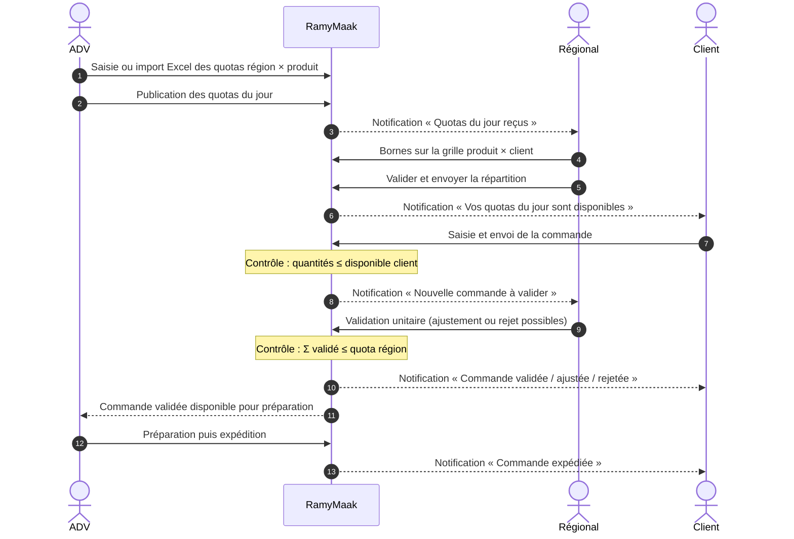
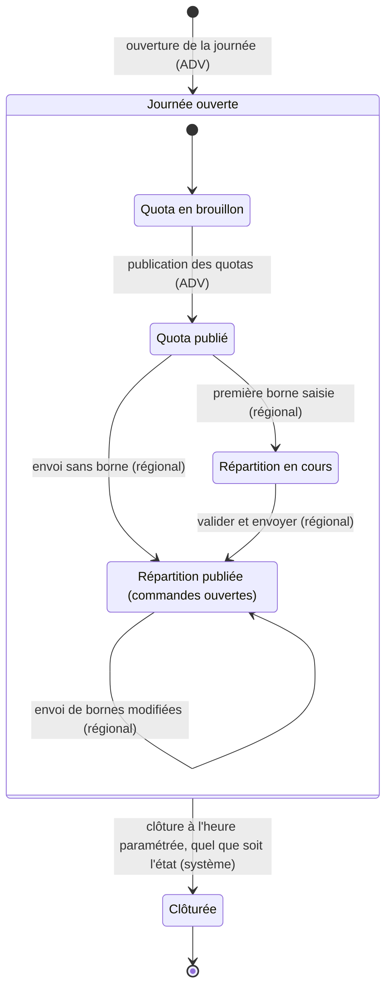
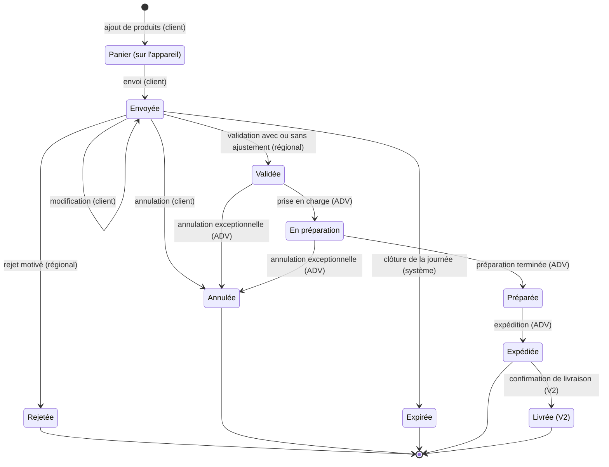
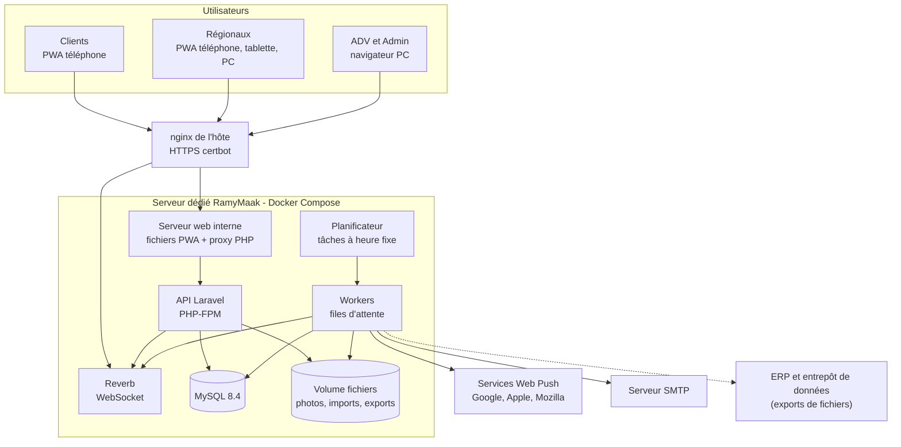
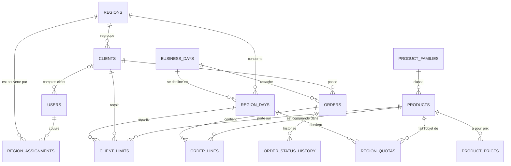

# RamyMaak — Spécification technique

**Plateforme B2B de prise de commandes sous quotas — Ramy (GROUP-SAFA)**

| Élément | Valeur |
|---|---|
| Version | 1.0 — version initiale |
| Date | 08/10/2026 |
| Statut | Brouillon à valider (voir §17 Décisions proposées et §18 Points ouverts) |
| Émetteur | DSI — GROUP-SAFA |
| Lecteurs | Direction commerciale et ADV Ramy, DSI, équipe de développement, exploitation |

---

## Sommaire

0. Conventions du document
1. Présentation (contexte, objectifs, périmètre, hypothèses)
2. Glossaire métier
3. Acteurs, rôles et périmètres
4. Processus métier quotidien
5. Règles de gestion
6. Cycles de vie (machines à états)
7. Spécifications fonctionnelles par module
8. Imports Excel
9. Architecture technique
10. Modèle de données
11. API REST
12. Sécurité
13. Exigences non fonctionnelles
14. Hébergement, déploiement et exploitation
15. Tests et recette
16. Découpage en lots
17. Journal des décisions proposées
18. Points ouverts

- Annexe A — Glossaire technique « pour comprendre »
- Annexe B — Modèles de fichiers Excel

---

## 0. Conventions du document

| Préfixe | Signification |
|---|---|
| `H-xx` | Hypothèse de travail retenue en l'absence de précision |
| `RG-xx` | Règle de gestion (comportement métier garanti par le système) |
| `EF-xx` | Exigence fonctionnelle |
| `ENF-xx` | Exigence non fonctionnelle (performance, sécurité, exploitation…) |
| `N-xx` | Notification |
| `D-xx` | Décision proposée, à valider |
| `Q-xx` | Question ouverte à trancher par le métier |

- **Priorités (MoSCoW)** : **M** = indispensable en V1 · **S** = souhaitable en V1 · **C** = si le temps le permet · **W** = hors V1.
- Les noms techniques (tables, champs, API) sont en anglais ; tous les libellés d'écran sont en français.
- Les encadrés **💡 Pour comprendre** expliquent un concept technique en termes simples. L'Annexe A reprend l'ensemble des termes techniques.

---

## 1. Présentation

### 1.1 Contexte

RamyMaak est la plateforme B2B par laquelle les clients de Ramy passent leurs commandes. Les volumes disponibles étant contingentés, chaque journée suit une chaîne de répartition à trois niveaux :

> **ADV** (quota par région et par produit) → **Régional** (plafond par client et par produit) → **Client** (commande)

La chaîne remonte ensuite : le régional valide les commandes une par une, puis l'ADV les prépare et les expédie.

### 1.2 Objectifs

1. Digitaliser de bout en bout le cycle quotidien : quotas → répartition → commandes → validation → préparation.
2. Garantir **par le système**, et non par contrôle manuel, qu'aucun niveau ne dépasse l'enveloppe qui lui est attribuée.
3. Donner à chaque acteur une visibilité en temps réel (grille produit × client, suivi de consommation des quotas).
4. Offrir aux clients et aux régionaux une application mobile installable (PWA), utilisable sur un réseau mobile faible.
5. Tracer toutes les décisions : qui a fixé, modifié, publié ou validé quoi, et quand.

### 1.3 Périmètre V1

| Module | Contenu | Priorité | Support |
|---|---|:-:|---|
| Comptes et accès | Identifiant / mot de passe, rôles, périmètres des régionaux | M | Tous |
| Référentiels | Produits (photos, prix), clients, régions, affectations | M | Back-office web |
| Quotas région | Saisie, import Excel, publication | M | Back-office web (ADV) |
| Répartition | Bornes par client sur grille produit × client, publication | M | PWA régional |
| Commandes | Catalogue mobile, saisie, envoi, suivi | M | PWA client |
| Validation | Validation unitaire, ajustement, rejet | M | PWA régional |
| Traitement ADV | Préparation, expédition, documents, exports | M | Back-office web |
| Notifications | Centre de notifications, notifications push, temps réel | M | Tous |
| Pilotage | Tableaux de bord de consommation des quotas | S | Back-office et PWA régional |
| Hors ligne | Consultation et panier hors ligne, envoi différé | S | PWA client |

### 1.4 Hors périmètre V1

- Paiement en ligne et facturation (la facture reste émise par l'ERP).
- Gestion de stock, de production et des tournées de livraison.
- Contrôle de l'encours / plafond de crédit client (voir Q-09).
- SMS et WhatsApp : aucune passerelle SMS n'est disponible à ce jour ; l'architecture des notifications permet de les ajouter plus tard.
- Interface en arabe : prévue en V1.1 (l'internationalisation et l'affichage de droite à gauche sont préparés dès la V1).
- Application native (APK / App Store) : la PWA la remplace.
- Intégration temps réel avec l'ERP : la V1 se limite à des exports de fichiers.

### 1.5 Hypothèses structurantes

| ID | Hypothèse |
|---|---|
| H-01 | Quotas, bornes et commandes s'expriment en **unité de vente (UV)** propre à chaque produit (fardeau, carton…), en nombres entiers. |
| H-02 | Un client appartient à **une seule région**. Une région a **un seul régional titulaire** à un instant donné ; un régional peut couvrir plusieurs régions. Pour partager une région entre deux régionaux, on la scinde en deux régions (l'ADV fixe alors un quota pour chacune). |
| H-03 | La **journée commerciale J** est la journée de commande ; la date de livraison prévue (J ou J+1) est un paramètre de la journée. |
| H-04 | Une borne client est un **plafond** (maximum). Elle est facultative : sans borne, le client est limité par le reste disponible de la région (paramétrable, RG-B04). |
| H-05 | La somme des bornes peut dépasser le quota région (**surallocation** volontaire, signalée). La garantie finale est le contrôle « Σ validé ≤ quota région » au moment de la validation. |
| H-06 | Les quotas non consommés **ne sont pas reportés** au lendemain. |
| H-07 | Un client passe par défaut **une commande par journée** (paramétrable). Il peut la modifier ou l'annuler tant qu'elle n'est pas validée et que l'heure limite n'est pas atteinte. |
| H-08 | À la validation, le régional peut **réduire** les quantités (jamais les augmenter), avec un motif. |
| H-09 | **Prix unique** par produit (tarif général) avec historique ; le prix est figé sur la commande au moment de l'envoi. |
| H-10 | Fuseau horaire de référence **Africa/Algiers** ; l'heure du serveur fait foi pour toutes les heures limites. |

---

## 2. Glossaire métier

| Terme | Définition |
|---|---|
| ADV | Administration des ventes : fixe les quotas par région et par produit, puis prépare et expédie les commandes validées. |
| Régional | Responsable commercial d'une ou plusieurs régions : répartit le quota de sa région entre ses clients et valide leurs commandes. |
| Client | Entreprise cliente de Ramy qui commande via l'application ; elle peut disposer d'un ou plusieurs comptes utilisateurs. |
| Journée commerciale (J) | Journée à laquelle se rattachent les quotas, les bornes et les commandes. |
| Quota région — Q(r,p) | Quantité maximale du produit p pouvant être **validée** dans la région r pendant la journée. |
| Borne client — B(c,p) | Plafond du produit p fixé par le régional pour le client c pendant la journée. |
| Répartition | Ensemble des bornes d'une région pour une journée. « Publier la répartition » ouvre la prise de commande aux clients de la région. |
| Quantité engagée — E(c,p) | Quantité déjà réservée par le client : commandes envoyées non encore traitées + quantités validées. |
| Reste région — R(r,p) | Quota région − quantités déjà validées dans la région. |
| Surallocation | Situation où la somme des bornes d'un produit dépasse le quota région (autorisée et signalée). |
| Publication | Action qui rend visibles des quotas ou des bornes jusque-là en brouillon, et déclenche les notifications. |
| Heure limite | Heure au-delà de laquelle une action est bloquée ou signalée (répartition, commande, validation, clôture). |
| UV | Unité de vente : conditionnement commandable d'un produit (fardeau, carton…). |

---

## 3. Acteurs, rôles et périmètres

### 3.1 Rôles

| Rôle | Mission | Interface | Données accessibles |
|---|---|---|---|
| **Admin** | Administre la plateforme : comptes, rôles, régions, affectations, référentiels, paramètres, audit. N'intervient pas dans le flux opérationnel (séparation des tâches). | Back-office web | Toutes |
| **ADV** | Fixe et publie les quotas ; suit la journée ; prépare et expédie les commandes validées. | Back-office web (PC) | Toutes les régions, ou une liste de régions si plusieurs équipes ADV ou sites d'expédition coexistent |
| **Régional** | Fixe et publie les bornes de ses clients ; valide les commandes ; suit ses clients. | PWA (téléphone, tablette, PC) | Clients de ses régions (affectations actives) |
| **Client** | Consulte le catalogue et ses quotas ; saisit, envoie et suit ses commandes. | PWA (téléphone) | Ses propres données |

### 3.2 Matrice des droits

Légende : ✅ autorisé · 🔶 limité à son périmètre · 👁 lecture seule · ❌ interdit

| Domaine | Action | Admin | ADV | Régional | Client |
|---|---|:-:|:-:|:-:|:-:|
| Comptes | Créer, modifier, désactiver des comptes ; attribuer rôles et affectations | ✅ | ❌ | ❌ | ❌ |
| Comptes | Réinitialiser le mot de passe d'un compte client | ✅ | ❌ | 🔶 | ❌ |
| Comptes | Changer son propre mot de passe | ✅ | ✅ | ✅ | ✅ |
| Référentiels | Régions et affectations | ✅ | 👁 | 👁 (les siennes) | ❌ |
| Référentiels | Clients | ✅ | 👁 | 👁 🔶 | 👁 (sa fiche) |
| Référentiels | Produits, photos, prix | ✅ | ✅ *(option)* | 👁 | 👁 (catalogue) |
| Quotas région | Saisir, importer, publier, modifier | ❌ | ✅ | ❌ | ❌ |
| Quotas région | Consulter | 👁 | ✅ | 👁 🔶 | ❌ |
| Bornes | Saisir, importer, publier, modifier | ❌ | ❌ | 🔶 | ❌ |
| Bornes | Consulter | 👁 | 👁 | 🔶 | 👁 (les siennes) |
| Commandes | Créer, modifier, annuler avant validation | ❌ | ❌ | ❌ | 🔶 (les siennes) |
| Commandes | Valider, ajuster, rejeter | ❌ | ❌ | 🔶 | ❌ |
| Commandes | Préparer, expédier, éditer les documents | ❌ | ✅ | ❌ | ❌ |
| Commandes | Annulation exceptionnelle d'une commande validée | ❌ | ✅ | ❌ | ❌ |
| Commandes | Consulter | 👁 | ✅ | 🔶 | 🔶 (les siennes) |
| Journée | Modifier ou prolonger une heure limite | ✅ | ✅ | ❌ | ❌ |
| Pilotage | Tableaux de bord et exports | ✅ | ✅ | 🔶 | ❌ |
| Paramètres | Paramètres généraux | ✅ | ❌ | ❌ | ❌ |
| Audit | Journal d'audit | ✅ | ❌ | ❌ | ❌ |

Les droits sont implémentés sous forme de **permissions** regroupées en **rôles** (ex. `quota.publish`, `limit.edit`, `order.validate`) : un rôle peut être ajusté sans modifier le code.

### 3.3 Périmètre du régional

- **RG-S01** — Le périmètre d'un régional est **calculé** : ce sont les clients (actifs ou bloqués) des régions sur lesquelles il a une affectation active, titulaire ou suppléant, à la date de la journée concernée.
- **RG-S02** — Le périmètre est appliqué **côté serveur** à chaque requête (filtrage des listes et contrôle unitaire de chaque objet), jamais uniquement dans l'interface.
- **RG-S03** — Un changement d'affectation prend effet immédiatement ; l'historique des affectations est conservé et les actions passées restent attribuées à leur auteur.
- **RG-S04** — Le changement de région d'un client prend effet à la **journée suivante**, pour ne pas fausser les compteurs d'une journée en cours.
- **RG-S05** — Périmètre ADV (option) : toutes les régions par défaut ; restreint à une liste de régions si plusieurs équipes ADV ou sites d'expédition coexistent.

### 3.4 Suppléance

L'Admin peut affecter un **suppléant** à une région pour une période (date de début, date de fin). Pendant cette période, le suppléant dispose des mêmes droits que le titulaire sur la région, les deux reçoivent les notifications, et chaque action est tracée au nom de son auteur réel. Une absence ne bloque ainsi jamais la répartition ni la validation d'une région.

### 3.5 Statuts des comptes et des clients

| Objet | Statut | Effet |
|---|---|---|
| Compte utilisateur | Actif | Accès normal |
| Compte utilisateur | Verrouillé temporairement | Après trop d'échecs de connexion (EF-AUTH-04) |
| Compte utilisateur | Désactivé | Connexion impossible, toutes les sessions révoquées |
| Client | Actif | Peut commander |
| Client | Bloqué | Peut se connecter et consulter, **ne peut pas commander** (décision commerciale ou financière) |
| Client | Inactif | Archivé : hors périmètre, comptes désactivés |

---

## 4. Processus métier quotidien

### 4.1 Vue d'ensemble



### 4.2 Déroulé détaillé

| # | Acteur | Action | Contrôles du système | Résultat |
|:-:|---|---|---|---|
| 1 | ADV | Ouvre la journée J et saisit ou importe les quotas région × produit | Produits et régions actifs ; quantités entières ≥ 0 ; rapport d'import | Quotas en **brouillon**, invisibles des régionaux |
| 2 | ADV | Publie les quotas (toutes les régions ou région par région) | Au moins un quota > 0 pour la région | Régionaux de la région notifiés (N-01) |
| 3 | Régional | Saisit les bornes sur la grille produit × client (ou reprend J-1, ou importe un fichier) | Bornes entières ≥ 0 ; borne ≤ quota région ; alerte de surallocation | Répartition en **brouillon**, invisible des clients |
| 4 | Régional | Valide et envoie la répartition | Quotas de la région publiés | Clients de la région notifiés (N-03) ; prise de commande ouverte |
| 5 | Client | Saisit sa commande et l'envoie | Répartition publiée, client non bloqué, avant l'heure limite ; chaque quantité ≤ disponible client (RG-C03) | Commande **Envoyée** ; régional notifié (N-05) ; grille mise à jour en temps réel |
| 6 | Régional | Consulte les commandes reçues (non validées) et la grille | — | — |
| 7 | Régional | Valide les commandes une par une (réduction possible) ou les rejette | Σ validé + quantité ≤ quota région (RG-V02) ; ≤ borne (RG-V03) ; version à jour (RG-V06) | Commande **Validée** ou **Rejetée** ; client notifié (N-07) ; ADV notifiée (N-08) |
| 8 | ADV | Prend en charge les commandes validées, les prépare puis les expédie | — | **En préparation** → **Préparée** → **Expédiée** ; client notifié (N-09) |
| 9 | Système | Clôture la journée à l'heure paramétrée | — | Commandes non validées **Expirées** ; quotas non consommés perdus |

### 4.3 Calendrier type et heures limites

Valeurs **proposées par défaut**, paramétrables globalement et modifiables pour une journée donnée par l'ADV.

| Heure (J) | Jalon | Comportement |
|---|---|---|
| Veille | Préparation anticipée des quotas de J | Brouillon ; publication manuelle ou programmée (C) |
| 08:00 | Publication des quotas par l'ADV | Objectif, non bloquant |
| 10:00 | Heure limite de **répartition** (régional) | Rappel à 09:30 (N-10) ; alerte ADV à 10:00 (N-13) ; non bloquante |
| 13:00 | Heure limite de **commande** (client) | Rappel à 12:00 aux clients sans commande (N-11) ; **bloquante** |
| 15:00 | Heure limite de **validation** (régional) | Rappel à 14:30 (N-12) ; non bloquante par défaut (paramétrable) |
| Après validation | Préparation et expédition (ADV) | Sans heure limite |
| 23:00 | **Clôture** automatique de la journée | Voir §4.4 |

- L'ADV peut **prolonger** une heure limite pour une région donnée (ex. répartition tardive) ; l'action est tracée (RG-A05).
- Les jours ouvrés (par défaut du dimanche au jeudi) sont paramétrables ; aucun rappel n'est envoyé une journée sans quotas.

### 4.4 Clôture de la journée

À l'heure de clôture, le système :

1. passe les commandes encore **Envoyées** au statut **Expirée** et notifie les clients concernés (N-14) ;
2. passe les journées régionales au statut **Clôturée** : quotas et bornes ne sont plus modifiables ;
3. fige les données de la journée pour le reporting ; les quotas non consommés sont perdus (H-06).

Le traitement ADV des commandes déjà validées (préparation, expédition) se poursuit normalement après la clôture.

---

## 5. Règles de gestion

### 5.1 Notations et formules

Pour une journée J, une région r, un produit p et un client c de la région r :

| Symbole | Définition | Origine |
|---|---|---|
| Q(r,p) | Quota région **publié** | Saisi par l'ADV |
| B(c,p) | Borne client **publiée** (peut être absente) | Saisie par le régional |
| S(c,p) | Σ des quantités demandées dans les commandes **Envoyées** du client | Calculé |
| V(c,p) | Σ des quantités **validées** du client (commandes Validées et statuts suivants, hors Annulées) | Calculé |
| E(c,p) | Quantité engagée = S(c,p) + V(c,p) | Calculé |
| V(r,p) | Σ validé dans la région = somme des V(c,p) | **Compteur en base** |
| S(r,p) | Σ en attente de validation dans la région = somme des S(c,p) | Calculé |
| R(r,p) | Reste région = Q(r,p) − V(r,p) | Calculé |
| ΣB(r,p) | Somme des bornes de la région | Calculé |

**Disponible client D(c,p)** — quantité maximale que le client peut encore demander (contrôle à l'envoi) :

```text
si une borne existe                  : D = max(0, min( B(c,p) − E(c,p) , R(r,p) ))
si aucune borne, politique LIBRE     : D = max(0, R(r,p))
si aucune borne, politique OBLIGATOIRE : D = 0
```

E(c,p) est calculée **hors** commande en cours de modification.

**Invariants garantis par le système**

| Invariant | Garanti par |
|---|---|
| I-1 : V(r,p) ≤ Q(r,p) pour toute journée, région et produit | La base de données elle-même (mise à jour conditionnelle + contrainte CHECK, §5.8) |
| I-2 : V(c,p) ≤ B(c,p) lorsque la borne existe | Contrôle transactionnel à la validation (RG-V03) |
| I-3 : un même envoi répété ne crée qu'une seule commande | Identifiant d'envoi unique (RG-C07) |

### 5.2 Quotas région (ADV)

- **RG-Q01** — Un quota est défini par (journée, région, produit) ; quantité entière ≥ 0. L'absence de quota (ou 0) signifie que le produit n'est pas commandable dans la région ce jour-là.
- **RG-Q02** — Seuls les produits actifs et les régions actives peuvent recevoir un quota.
- **RG-Q03** — Toute saisie est d'abord un **brouillon** ; elle ne devient visible des régionaux qu'à la **publication**. Ce principe vaut aussi pour les modifications après publication (« Publier les modifications »).
- **RG-Q04** — La publication se fait pour une région, une sélection de régions ou toutes les régions ; elle notifie les régionaux concernés (N-01 à la première publication, N-02 ensuite).
- **RG-Q05** — Après publication, un quota peut être **augmenté** à tout moment avant la clôture. Il peut être **diminué** sans jamais descendre sous V(r,p) (quantité déjà validée) ; sinon la publication est refusée (`QUOTA_BELOW_VALIDATED`).
- **RG-Q06** — Une diminution qui crée une surallocation (ΣB > Q) n'invalide pas la répartition : elle est signalée au régional, et le contrôle à la validation protège le quota.
- **RG-Q07** — Un produit ayant un quota publié > 0 sur la journée en cours ne peut être désactivé qu'avec effet à la journée suivante.
- **RG-Q08** — Chaque publication incrémente la version des quotas de la région et est tracée avec les valeurs avant / après.
- **RG-Q09** — Un import Excel ne publie jamais automatiquement (§8.1).

> 💡 **Pour comprendre — brouillon puis publication.** C'est le principe d'un e-mail en brouillon : l'ADV peut corriger 50 cases sans que le régional voie des valeurs intermédiaires ni reçoive 50 notifications. Un seul clic sur « Publier » envoie l'ensemble, avec une seule notification. Le même principe s'applique aux bornes du régional.

### 5.3 Bornes client (régional)

- **RG-B01** — Une borne est un plafond entier ≥ 0 pour (journée, client, produit). **0** = produit interdit à ce client ce jour ; **case vide** = pas de borne.
- **RG-B02** — Le régional ne saisit des bornes que pour les clients de son périmètre et pour les produits ayant un quota publié > 0 dans la région.
- **RG-B03** — Une borne ne peut pas dépasser le quota de la région : B(c,p) ≤ Q(r,p).
- **RG-B04** — Politique en l'absence de borne (paramètre global) : **LIBRE** (par défaut), le client est limité par le reste région R(r,p) ; **OBLIGATOIRE**, un produit sans borne n'est pas commandable par le client.
- **RG-B05** — La surallocation (ΣB(r,p) > Q(r,p)) est **autorisée** et signalée en orange sur la grille, sans blocage.
- **RG-B06** — La répartition ne peut être publiée qu'après les quotas de la région. Sa publication ouvre la prise de commande et notifie (N-03) tous les clients actifs de la région ; en politique OBLIGATOIRE, seulement ceux qui ont au moins une borne > 0.
- **RG-B07** — Après publication, le régional peut modifier des bornes jusqu'à la clôture (brouillon puis « Envoyer les modifications »), sans descendre sous V(c,p). Si une nouvelle borne est inférieure à E(c,p), un avertissement indique que la commande en attente devra être réduite à la validation. Seuls les clients impactés sont notifiés (N-04).
- **RG-B08** — « Reprendre J-1 » copie les bornes de la dernière journée publiée de la région, pour les produits disponibles à J, plafonnées au quota du jour ; mode **écraser** ou **compléter les cases vides**.
- **RG-B09** — Le brouillon est enregistré automatiquement à chaque saisie : aucune perte en cas de fermeture de l'application.

### 5.4 Commandes client

- **RG-C01** — Un client peut envoyer une commande si : la répartition de sa région est publiée, la journée n'est pas clôturée, l'heure limite de commande n'est pas atteinte (heure serveur), et le client est actif (non bloqué).
- **RG-C02** — Une ligne = un produit (au plus une fois par commande), quantité entière > 0, produit disponible dans la région.
- **RG-C03** — Pour chaque ligne : quantité ≤ D(c,p) (§5.1), contrôlé à l'envoi et à chaque modification. En cas d'échec, le message indique le produit et la quantité maximale possible.
- **RG-C04** — Nombre de commandes par client et par journée : paramètre (défaut **1**). Les commandes Rejetées, Annulées et Expirées ne comptent pas. Si plusieurs commandes sont permises, RG-C03 s'applique au cumul (c'est le rôle de E(c,p)).
- **RG-C05** — Le client peut modifier ou annuler une commande **Envoyée** tant qu'elle n'est ni validée ni rejetée et que l'heure limite n'est pas atteinte. Chaque modification incrémente la version de la commande et notifie le régional (N-06).
- **RG-C06** — Montant minimum de commande : paramètre optionnel, désactivé par défaut.
- **RG-C07** — **Idempotence** : chaque envoi porte un identifiant unique généré par l'appareil (`client_request_id`). Un renvoi (double appui, reprise réseau) renvoie la commande existante au lieu d'en créer une seconde.
- **RG-C08** — Une commande préparée hors ligne est transmise au retour du réseau ; le serveur rejoue **tous** les contrôles avec l'heure serveur. Si l'heure limite est dépassée entre-temps, l'envoi est refusé et le client en est informé.
- **RG-C09** — Le client voit sa borne et son disponible lorsqu'une borne existe ; sans borne, aucune quantité n'est affichée mais le contrôle s'applique (D = reste région). Le client ne voit jamais le quota de la région ni les commandes des autres clients.

> 💡 **Pour comprendre — idempotence.** Un client appuie sur « Envoyer » dans une zone mal couverte ; l'application ne reçoit pas la réponse et renvoie la demande. Sans précaution, le serveur créerait deux commandes. Grâce à l'identifiant unique attaché à l'envoi, le serveur reconnaît la seconde demande comme un doublon et renvoie simplement la commande déjà créée.

### 5.5 Validation par le régional

- **RG-V01** — Le régional traite les commandes de son périmètre **une par une**, présentées par ordre d'envoi (première envoyée, première affichée).
- **RG-V02** — **Plafond région** : pour chaque ligne, V(r,p) + quantité validée ≤ Q(r,p). Si une seule ligne dépasse, **toute** la validation est refusée (pas de validation partielle implicite) et le détail par produit indique la quantité maximale validable.
- **RG-V03** — **Plafond client** : si une borne existe, V(c,p) + quantité validée ≤ B(c,p). Pour accorder davantage, le régional relève d'abord la borne.
- **RG-V04** — **Ajustement** : le régional peut réduire une ou plusieurs lignes (0 ≤ quantité validée ≤ quantité demandée) ; un motif est obligatoire pour chaque ligne réduite. La commande est « Validée avec ajustement » et le client voit l'écart. Le bouton « Ajuster au maximum possible » propose automatiquement min(demandé, R(r,p), B(c,p) − V(c,p)).
- **RG-V05** — Une commande dont toutes les lignes seraient à 0 doit être **rejetée** (motif obligatoire). Un rejet libère la quantité en attente ; le client peut envoyer une nouvelle commande avant l'heure limite.
- **RG-V06** — **Contrôle de version** : la validation transmet la version de la commande affichée ; si le client l'a modifiée entre-temps, la validation est refusée (`VERSION_CONFLICT`) et l'écran se recharge.
- **RG-V07** — Une commande validée n'est plus modifiable par le client ni par le régional. Seule l'ADV peut l'annuler (exceptionnel, motif obligatoire, tant que la préparation n'est pas terminée) ; les quantités sont alors restituées au reste région.
- **RG-V08** — L'heure limite de validation est non bloquante par défaut (rappels et alerte) ; elle peut être rendue bloquante par paramètre.

### 5.6 Traitement par l'ADV

- **RG-A01** — L'ADV reçoit en temps réel les commandes validées de son périmètre, triées par heure de validation et filtrables (région, dépôt, client, produit, statut).
- **RG-A02** — Statuts de traitement : Validée → En préparation → Préparée → Expédiée (→ Livrée en V2). Chaque passage est horodaté et tracé ; les changements de statut sont possibles en masse sur une sélection.
- **RG-A03** — Quantité expédiée = quantité validée par défaut ; une quantité inférieure peut être saisie (rupture) avec un motif. Elle ne modifie pas la consommation du quota, qui reste la quantité validée (Q-16).
- **RG-A04** — Documents : bon de commande client (PDF) ; bon de préparation consolidé par produit, par région ou par dépôt (PDF et Excel, avec équivalent palettes si le colisage est renseigné) ; export des commandes du jour (Excel / CSV au format d'import ERP à définir, Q-14).
- **RG-A05** — L'ADV peut prolonger une heure limite pour une journée et une région ; l'action est tracée et les acteurs concernés sont notifiés.

### 5.7 Prix et montants

- **RG-P01** — Chaque produit a un prix HT par UV, en dinars algériens (DA), avec une date d'effet ; un seul prix est en vigueur à une date donnée.
- **RG-P02** — Le taux de TVA est porté par la fiche produit.
- **RG-P03** — Le prix HT et le taux de TVA sont **figés sur la ligne** au moment de l'envoi ; un changement de prix ultérieur ne modifie pas les commandes déjà envoyées.
- **RG-P04** — Montant de ligne = prix × quantité, arrondi à 2 décimales ; totaux = somme des lignes. Dès la validation, les montants sont recalculés sur les quantités validées.
- **RG-P05** — Les montants affichés sont indicatifs : la facture émise par l'ERP fait foi.

### 5.8 Garantie des plafonds en accès simultané

> 💡 **Pour comprendre — pourquoi un verrou ?** Il reste 40 fardeaux de jus d'orange dans la région. Le régional titulaire et son suppléant valident, à la même seconde, deux commandes de 40. Sans précaution, les deux traitements lisent « reste = 40 », valident chacun 40… et la région se retrouve à 80 validés pour un quota de 40. La solution : demander à la base de données d'ajouter 40 **seulement si** le total reste inférieur ou égal au quota, en une seule opération indivisible. La seconde validation trouve alors un reste de 0 et elle est refusée.

**Validation d'une commande** (une seule transaction) :

1. Incrémenter la version de la commande **à condition** qu'elle soit toujours au statut Envoyée et à la version transmise (`UPDATE orders SET version = version + 1 WHERE id = ? AND status = 'SUBMITTED' AND version = ?`) ; 0 ligne modifiée → `VERSION_CONFLICT`.
2. Pour chaque ligne, dans l'ordre croissant des identifiants produit (ce qui évite les interblocages) :
   - relire la borne du client avec verrou (`SELECT … FOR UPDATE`) et contrôler RG-V03 ;
   - exécuter la mise à jour conditionnelle du compteur région :

     ```sql
     UPDATE region_quotas
        SET validated_qty = validated_qty + :qty
      WHERE region_day_id = :region_day_id
        AND product_id    = :product_id
        AND validated_qty + :qty <= quantity;
     -- 0 ligne modifiée => quota dépassé => annulation (ROLLBACK) de toute la transaction
     ```

3. Enregistrer les quantités validées, le statut, l'auteur, l'horodatage, l'historique et l'audit.
4. Valider la transaction (COMMIT), **puis seulement** diffuser les événements temps réel et les notifications.

Remarque d'implémentation : une ligne validée à 0 ne déclenche pas de mise à jour du compteur (MySQL compte 0 ligne modifiée lorsqu'une valeur ne change pas, ce qui serait interprété à tort comme un dépassement).

**Filet de sécurité dans la base** : même en cas d'erreur de programmation, la base refuse tout dépassement grâce à une contrainte :

```sql
ALTER TABLE region_quotas
  ADD CONSTRAINT chk_region_quota_not_exceeded CHECK (validated_qty <= quantity);
```

**Envoi d'une commande par le client** (une seule transaction) : verrou sur la ligne du client (`SELECT … FROM clients WHERE id = ? FOR UPDATE`) pour sérialiser les envois d'un même client depuis plusieurs appareils, recalcul de E(c,p) et D(c,p) pour chaque produit, création de la commande avec son `client_request_id` unique.

**Diminution d'un quota par l'ADV** : mise à jour conditionnelle `UPDATE region_quotas SET quantity = :new WHERE id = :id AND validated_qty <= :new` ; 0 ligne modifiée → `QUOTA_BELOW_VALIDATED`.

**Réconciliation nocturne** : une tâche recalcule V(r,p) à partir des lignes de commande et le compare au compteur ; tout écart déclenche une alerte technique.

---

## 6. Cycles de vie (machines à états)

### 6.1 Journée régionale (une région pour une journée)



« Journée ouverte » regroupe les quatre premiers statuts (ce n'est pas un statut en base) : la clôture s'applique quel que soit le statut atteint par la région. Les modifications de quotas après publication ne changent pas le statut : elles incrémentent `quota_version` et déclenchent N-02. De même, l'envoi de bornes modifiées incrémente `distribution_version` et déclenche N-04.

### 6.2 Commande



Le **panier** n'existe que sur l'appareil du client : il ne réserve aucune quantité et ne correspond à aucun statut en base.

### 6.3 Transitions de la commande

| De | Vers | Acteur | Conditions | Effet sur les quantités |
|---|---|---|---|---|
| Panier | Envoyée | Client | RG-C01 à RG-C03 | S(c,p) augmente |
| Envoyée | Envoyée (modifiée) | Client | RG-C05 ; version incrémentée | S(c,p) recalculée |
| Envoyée | Annulée | Client | Avant décision et avant l'heure limite | S(c,p) diminue |
| Envoyée | Validée | Régional | RG-V02, RG-V03, RG-V06 | S(c,p) diminue ; V(c,p) et V(r,p) augmentent des quantités validées |
| Envoyée | Rejetée | Régional | Motif obligatoire | S(c,p) diminue |
| Envoyée | Expirée | Système | Clôture de la journée | S(c,p) diminue |
| Validée | En préparation | ADV | — | — |
| En préparation | Préparée | ADV | Quantités préparées confirmées | — |
| Préparée | Expédiée | ADV | Référence du bon de livraison (option) | — |
| Validée ou En préparation | Annulée | ADV | Exceptionnel, motif obligatoire | V(c,p) et V(r,p) diminuent |
| Expédiée | Livrée | ADV | V2 | — |

Toute transition non listée est refusée par le serveur (`INVALID_TRANSITION`). Chaque transition est enregistrée dans l'historique de la commande (auteur, date, commentaire).

---

## 7. Spécifications fonctionnelles par module

### 7.1 Authentification et comptes

| ID | Exigence | Prio |
|---|---|:-:|
| EF-AUTH-01 | Connexion par identifiant + mot de passe. Identifiant unique : login nominatif pour le personnel, **code client** pour les comptes clients (les clients n'ont pas tous une adresse e-mail). | M |
| EF-AUTH-02 | Changement de mot de passe obligatoire à la première connexion et après toute réinitialisation. | M |
| EF-AUTH-03 | Politique de mot de passe paramétrable — par défaut : 8 caractères minimum avec lettres et chiffres (12 pour Admin et ADV) ; refus des mots de passe les plus courants. | M |
| EF-AUTH-04 | Verrouillage temporaire de 15 minutes après 5 échecs consécutifs ; limitation des tentatives par adresse IP ; message d'erreur générique (ne révèle pas si l'identifiant existe). | M |
| EF-AUTH-05 | Mot de passe oublié : réinitialisation par l'Admin, ou par le régional pour les comptes clients de son périmètre, qui génère un mot de passe temporaire à usage unique. Libre-service par e-mail si l'adresse est renseignée (S). | M |
| EF-AUTH-06 | Durée de session par rôle — par défaut : 30 jours sur un appareil de confiance (« Rester connecté ») pour clients et régionaux ; 12 h maximum, avec expiration après 2 h d'inactivité, pour Admin et ADV. | M |
| EF-AUTH-07 | « Me déconnecter de tous mes appareils » ; révocation immédiate de toutes les sessions à la désactivation d'un compte. | M |
| EF-AUTH-08 | Journal des connexions : succès, échecs, adresse IP, appareil. | M |
| EF-AUTH-09 | Double authentification (code TOTP) pour Admin et ADV. | C |

### 7.2 Administration

| ID | Exigence | Prio |
|---|---|:-:|
| EF-ADM-01 | Gestion des comptes : création, rôle, rattachement à un client (comptes clients), affectations aux régions (régionaux, ADV), activation, désactivation, réinitialisation du mot de passe. | M |
| EF-ADM-02 | Création en masse des comptes clients à partir du référentiel ; édition d'une **fiche d'accès PDF** par client (identifiant + mot de passe temporaire) à remettre en main propre. | S |
| EF-ADM-03 | Régions : code, libellé, dépôt d'expédition (option), titulaire, suppléants avec période. | M |
| EF-ADM-04 | Paramètres : heures limites par défaut, jours ouvrés, politique d'absence de borne, nombre de commandes par jour, montant minimum, durées de session, politique de mot de passe, canaux de notification, plage horaire sans push. | M |
| EF-ADM-05 | Listes de motifs paramétrables : rejet, ajustement, écart de préparation, annulation. | M |
| EF-ADM-06 | Consultation du journal d'audit : filtres par utilisateur, objet, action et période ; export. | M |

### 7.3 Catalogue produits

| ID | Exigence | Prio |
|---|---|:-:|
| EF-PRD-01 | Fiche produit : code article (= code ERP), désignation, désignation courte (affichage mobile), famille / gamme, format (ex. 1 L), libellé d'UV (ex. « Fardeau 6 × 1 L »), unités par UV, UV par palette (option), code EAN (option), taux de TVA, statut, ordre d'affichage. | M |
| EF-PRD-02 | Photos : 1 principale + 4 secondaires maximum ; JPEG, PNG ou WebP de 5 Mo maximum ; variantes générées automatiquement (§9.8) ; visuel par défaut si aucune photo. | M |
| EF-PRD-03 | Prix : historique avec date d'effet, prix futur programmable, saisie unitaire ou import Excel. | M |
| EF-PRD-04 | Import Excel du catalogue (création / mise à jour par code article). | M |
| EF-PRD-05 | Badges « Nouveau » et « Mis en avant ». | C |

**Affichage mobile (responsive)**

| Largeur d'écran | Présentation du catalogue |
|---|---|
| Téléphone (< 640 px) | **Liste compacte** par défaut : vignette 72 px, nom court, UV, prix, sélecteur de quantité — la présentation la plus rapide pour commander. Bascule possible en **galerie 2 colonnes**. |
| Tablette (640 à 1 024 px) | Galerie 3 colonnes |
| PC (> 1 024 px) | Galerie 4 à 6 colonnes et panier latéral |

- Familles en onglets défilant horizontalement ; recherche instantanée (nom, code).
- Fiche produit en panneau plein écran : carrousel de photos avec zoom, UV, prix HT et TTC, prix unitaire indicatif (prix de l'UV ÷ unités par UV).
- Images en chargement différé, à la taille de l'écran (`srcset`), avec emplacement réservé pour éviter les sauts de mise en page.
- Zones tactiles d'au moins 44 px ; clavier numérique pour les quantités (`inputmode="numeric"`) ; boutons − / + ; barre « panier » fixée en bas de l'écran.

### 7.4 Référentiel clients

| ID | Exigence | Prio |
|---|---|:-:|
| EF-CLI-01 | Fiche client : code (= code ERP), raison sociale, enseigne, catégorie (grossiste, distributeur…), région, adresse, wilaya, commune, coordonnées GPS (option), téléphones, e-mail, NIF, NIS, RC, article d'imposition, statut, comptes rattachés. | M |
| EF-CLI-02 | Import Excel (création / mise à jour par code client) ; un changement de région prend effet à la journée suivante (RG-S04). | M |
| EF-CLI-03 | Le régional consulte les fiches de son périmètre et appelle un client en un geste depuis son téléphone. | M |
| EF-CLI-04 | Blocage / déblocage d'un client avec motif (Admin), effet immédiat sur la prise de commande. | M |

### 7.5 Module ADV (back-office, PC)

| ID | Exigence | Prio |
|---|---|:-:|
| EF-ADV-01 | **Calendrier des journées** : statut de chaque journée et de chaque région ; accès direct à J et J+1. | M |
| EF-ADV-02 | **Matrice des quotas** produit (lignes, groupées par famille) × région (colonnes) : saisie au clavier comme dans un tableur, totaux par ligne et par colonne, cellules modifiées non publiées mises en évidence, « Copier depuis la journée… », import Excel (§8.1), publication par région, par sélection ou pour toutes les régions. | M |
| EF-ADV-03 | **Suivi de la journée** en temps réel : par région, statut de répartition, clients notifiés, commandes envoyées et validées, consommation V/Q par produit, produits épuisés ; alertes de retard. | M |
| EF-ADV-04 | **File des commandes validées** en temps réel : filtres, sélection multiple, changement de statut en masse, détail, impression du bon de commande. | M |
| EF-ADV-05 | **Bon de préparation consolidé** par région ou dépôt et par produit (UV et palettes), en PDF et Excel. | M |
| EF-ADV-06 | Saisie des quantités expédiées et de la référence du bon de livraison ; motifs d'écart. | S |
| EF-ADV-07 | Exports des commandes du jour (Excel / CSV), dont le format d'import ERP. | M |
| EF-ADV-08 | Programmation de la publication des quotas à une heure donnée. | C |

### 7.6 Module Régional (PWA)

| ID | Exigence | Prio |
|---|---|:-:|
| EF-REG-01 | **Ma journée** : statut (quotas reçus, répartition publiée, commandes à valider), heures limites, raccourcis ; liste des **clients sans commande** avec appel en un geste. | M |
| EF-REG-02 | **Grille produit × client** sur PC et tablette (détail ci-dessous). | M |
| EF-REG-03 | **Grille sur téléphone** (vue pivot) : choix d'un produit, puis liste des clients avec le champ borne et une barre de synthèse fixe (Q, ΣB, V, R) ; bascule « par client » vers la liste des produits d'un client. | M |
| EF-REG-04 | **Commandes** : onglets À valider (avec compteur), Validées, Rejetées ; tri par heure d'envoi ; arrivée en temps réel. | M |
| EF-REG-05 | **Détail et décision** : pour chaque ligne, quantité demandée, borne, déjà validé pour ce client, reste région, reste après validation ; actions Valider, Ajuster (motif), Rejeter (motif) ; en cas de dépassement, explication et bouton « Ajuster au maximum possible ». | M |
| EF-REG-06 | Import Excel des bornes (§8.2). | S |

**Grille produit × client (EF-REG-02)**

- Lignes : clients du périmètre (code et nom figés à gauche), avec recherche et filtre par catégorie.
- Colonnes : produits ayant un quota publié, groupés par famille, en-têtes figés.
- Cinq lignes de synthèse épinglées en haut : **Quota (Q)**, **Σ bornes (ΣB)**, **En attente (S)**, **Validé (V)**, **Reste (R)**.
- Cellule : borne modifiable et rappel des quantités en attente (S) et validées (V) du client.
- Trois modes d'affichage : **Bornes** (saisie), **Commandes** (S et V par client), **Reste**.
- Couleurs : orange si ΣB > Q (surallocation) ; rouge si R = 0 (épuisé) ; fond distinct pour les cellules modifiées non envoyées.
- Actions de masse : appliquer une valeur à une colonne ou à une sélection, effacer, **Reprendre J-1**, importer.
- Enregistrement automatique avec l'indicateur « Enregistré à 09:12 ».
- Bouton **Valider et envoyer aux clients** → récapitulatif (nombre de clients notifiés, produits en surallocation) → confirmation.
- Mise à jour en temps réel des valeurs S et V à l'arrivée et à la validation des commandes.

```text
Journée 08/10/2026 - Région CENTRE      Affichage : [Bornes] Commandes Reste      Enregistré à 09:12
+----------------------+-----------------+-----------------+-----------------+
|                      | Jus orange 1 L  | Jus pomme 1 L   | Lben 1 L        |
+----------------------+-----------------+-----------------+-----------------+
| Quota (Q)            |             500 |             300 |             800 |
| Σ bornes (ΣB)        |         (!) 620 |             280 |               - |
| En attente (S)       |             120 |              40 |             210 |
| Validé (V)           |             300 |             150 |             400 |
| Reste (R = Q - V)    |             200 |             150 |             400 |
+----------------------+-----------------+-----------------+-----------------+
| C0012 - Client A     | [ 50]  S10 V30  | [ 20]  S0  V20  | [  -]  S0  V60  |
| C0047 - Client B     | [100]  S80 V0   | [  -]  S0  V0   | [ 80]  S0  V80  |
| ...                  |                 |                 |                 |
+----------------------+-----------------+-----------------+-----------------+
[n] borne modifiable - [-] pas de borne - S en attente - V validé - (!) surallocation
                                                  [ Valider et envoyer aux clients ]
```

**Hors ligne** : lecture seule des dernières données reçues (bandeau « Hors ligne — données de 09:42 ») ; saisie des bornes et validation désactivées.

### 7.7 Module Client (PWA)

| ID | Exigence | Prio |
|---|---|:-:|
| EF-CLT-01 | **Accueil** : bandeau d'état de la journée (« En attente des quotas du jour » · « Commandes ouvertes jusqu'à 13:00 » · « Commandes clôturées ») ; commande du jour et son statut ; bouton « Commander ». | M |
| EF-CLT-02 | **Catalogue du jour** : produits disponibles dans la région (photo, nom, UV, prix HT et TTC, « Max : n » si une borne existe) ; sélecteur de quantité bloqué au disponible ; produits épuisés grisés. | M |
| EF-CLT-03 | **Panier** : lignes, totaux HT / TVA / TTC indicatifs, commentaire, bouton « Envoyer la commande » avec confirmation ; panier conservé automatiquement sur l'appareil. | M |
| EF-CLT-04 | **Mes commandes** : liste et détail ; frise de statut (Envoyée → Validée → En préparation → Expédiée) ; quantités demandées et validées, motifs ; modifier ou annuler si autorisé (RG-C05). | M |
| EF-CLT-05 | **Recommander** : pré-remplit le panier à partir d'une commande passée, plafonné aux disponibilités du jour. | S |
| EF-CLT-06 | **Profil** : changement de mot de passe, appareils connectés, préférences de notification, aide à l'installation de l'application. | M |
| EF-CLT-07 | **Hors ligne** : catalogue et dernières données consultables, panier modifiable, envoi différé avec état visible (« En attente d'envoi », « Envoyée », « Refusée : motif »). | S |

### 7.8 Notifications

| Code | Événement | Destinataires | Canaux | Exemple ou moment |
|---|---|---|---|---|
| N-01 | Quotas du jour publiés | Régionaux de la région (titulaire et suppléants) | In-app, push, e-mail (option) | « Quotas du 08/10 reçus — région Centre. À répartir avant 10:00. » |
| N-02 | Quotas modifiés après publication | Régionaux de la région | In-app, push | « L'ADV a modifié 3 quotas de la région Centre. » |
| N-03 | Répartition publiée | Clients de la région | In-app, push | « Vos quotas du 08/10 sont disponibles. Commandez avant 13:00. » |
| N-04 | Bornes modifiées | Clients impactés | In-app, push | « Vos quotas du jour ont été mis à jour. » |
| N-05 | Nouvelle commande envoyée | Régionaux de la région | In-app (temps réel), push regroupé | « 3 nouvelles commandes à valider. » |
| N-06 | Commande modifiée ou annulée par le client | Régionaux de la région | In-app | « Client A a modifié sa commande RMK-261008-00042. » |
| N-07 | Décision sur la commande : validée, ajustée, rejetée ou annulée | Client | In-app, push | « Votre commande RMK-261008-00042 est validée (2 lignes ajustées). » |
| N-08 | Commande validée à préparer | ADV | In-app (temps réel) | Compteur et liste mis à jour, sans push unitaire |
| N-09 | Commande expédiée | Client | In-app, push | « Votre commande RMK-261008-00042 a été expédiée. » |
| N-10 | Rappel de l'heure limite de répartition | Régionaux n'ayant pas publié | Push | 30 min avant l'heure limite |
| N-11 | Rappel de l'heure limite de commande | Clients notifiés sans commande | Push | 1 h avant l'heure limite |
| N-12 | Rappel des commandes à valider | Régionaux ayant des commandes en attente | Push | 30 min avant l'heure limite de validation |
| N-13 | Répartition non publiée à l'heure limite | ADV | In-app | À l'heure limite |
| N-14 | Commande expirée | Client | In-app, push | À la clôture |
| N-15 | Sécurité du compte (mot de passe réinitialisé) | Utilisateur | In-app, e-mail (option) | Immédiat |

- **EF-NOT-01** — Toute notification est enregistrée dans le **centre de notifications** (lu / non lu) ; le push n'est qu'un signal qui y renvoie.
- **EF-NOT-02** — Anti-saturation : les push de même type sont regroupés pour un même utilisateur (au plus 1 toutes les 5 minutes) ; aucun push entre 21:00 et 06:00 (paramétrable).
- **EF-NOT-03** — Contenu minimal (ni montants ni données commerciales sensibles) ; un appui sur la notification ouvre l'écran concerné.
- **EF-NOT-04** — L'utilisateur peut couper les rappels non critiques (N-10 à N-12).
- **EF-NOT-05** — Sur iPhone et iPad, le push ne fonctionne que si l'application est **installée sur l'écran d'accueil** (iOS 16.4 ou plus récent) ; la PWA guide l'utilisateur dans cette installation.
- **EF-NOT-06** — Les envois à destinataires multiples (ex. 150 clients d'une région) sont traités en tâche de fond (§9.7).

### 7.9 Tableaux de bord et exports

| ID | Exigence | Prio |
|---|---|:-:|
| EF-KPI-01 | ADV : consommation des quotas V/Q par région et par produit ; heure d'épuisement des produits. | S |
| EF-KPI-02 | **Demande non servie** = Σ demandé − Σ validé (ajustements et rejets), par produit et par région : indicateur clé pour la planification de la production. | S |
| EF-KPI-03 | Taux de commande (clients ayant commandé ÷ clients notifiés) ; délais moyens publication → répartition → envoi → validation → expédition. | S |
| EF-KPI-04 | Régional : avancement de sa journée, clients sans commande, consommation par produit. | M |
| EF-KPI-05 | Export Excel de toutes les listes et de tous les tableaux. | M |
| EF-KPI-06 | Alimentation de l'entrepôt de données du groupe (extraction nocturne). | W |

---

## 8. Imports Excel

### 8.1 Import des quotas (ADV)

**Gabarit** téléchargeable depuis l'écran de saisie, pré-rempli : une ligne par produit actif, une colonne par région active (modèle en Annexe B.1).

**Modes d'import**

- **Remplacer** : la journée prend exactement les valeurs du fichier ; une cellule vide vaut 0.
- **Compléter** : seules les cellules renseignées sont mises à jour ; une cellule vide ne change rien.

**Contrôles** (rapport par ligne et par colonne)

| Contrôle | Exemple de message |
|---|---|
| Format | « Fichier .xlsx attendu, 5 Mo maximum » |
| En-tête | « Colonne EST2 : code région inconnu » |
| Produit | « Ligne 14 : code produit P0999 inconnu ou inactif » |
| Doublon | « Ligne 22 : produit P0042 déjà présent ligne 9 » |
| Valeur | « Ligne 18, colonne OUEST : 12,5 n'est pas un entier positif » |
| Cohérence | « Ligne 9, colonne CENTRE : 250 inférieur aux 300 déjà validés » (journée déjà publiée) |

**Déroulé**

1. Dépôt du fichier (.xlsx uniquement, sans macros, 5 Mo maximum).
2. Analyse en tâche de fond, avec indicateur de progression.
3. Rapport : nombre de lignes correctes et en erreur, fichier d'erreurs annoté téléchargeable, **aperçu des changements** (valeur actuelle → nouvelle valeur).
4. Si le fichier contient au moins une erreur, il ne peut pas être appliqué : l'ADV corrige puis redépose.
5. Confirmation, puis application **en une seule transaction** (tout ou rien) : les valeurs sont enregistrées en brouillon.
6. Publication manuelle par l'ADV (RG-Q09).

Chaque import est historisé : fichier d'origine, auteur, date, mode, résultat.

### 8.2 Import des bornes (régional) — S

Même mécanisme. Le gabarit est pré-rempli avec les clients du périmètre en lignes et les produits disponibles du jour en colonnes (Annexe B.2). Une cellule vide signifie « pas de borne » en mode Remplacer, « inchangée » en mode Compléter.

### 8.3 Import des référentiels (Admin)

Clients, produits et prix (Annexes B.3 à B.5) : la clé est le code ERP ; création ou mise à jour ; même rapport d'erreurs et même principe du tout ou rien.

### 8.4 Sécurité des fichiers

- Seul le format .xlsx est accepté (.xlsm et .xls refusés) ; les formules sont lues comme valeurs calculées.
- Les fichiers sont stockés hors de la partie publique du serveur.
- À l'export, toute cellule commençant par `=`, `+`, `-` ou `@` est neutralisée (protection contre l'injection de formules dans Excel).

---

## 9. Architecture technique

### 9.1 Choix de la stack

| Couche | Choix recommandé | Alternative écartée | Justification |
|---|---|---|---|
| Back-end | **Laravel ≥ 12** (PHP ≥ 8.3) exposant une API REST | Laravel + Livewire (pages rendues par le serveur) | Socle maîtrisé par l'équipe et écosystème complet (authentification, files d'attente, notifications, WebSocket, Excel). Livewire est écarté pour la partie PWA : chaque interaction dépend du réseau, ce qui convient mal au hors ligne et à une grille de plusieurs milliers de cellules. |
| Front-end | **React 19 + TypeScript + Vite**, application unique (SPA) installable | Vue 3, Angular | React est déjà utilisé dans le groupe ; écosystème le plus riche pour les PWA et les grilles ; TypeScript détecte de nombreuses erreurs avant l'exécution. |
| PWA | **vite-plugin-pwa** (Workbox) | Service worker écrit à la main | Génère le manifeste et le service worker, gère les mises à jour et les stratégies de cache. |
| Base de données | **MySQL 8.4 LTS** | PostgreSQL | Aligné sur le socle existant ; contraintes CHECK, transactions et verrous de ligne suffisent aux garanties du §5.8. |
| Temps réel | **Laravel Reverb** (WebSocket) + Laravel Echo | Rafraîchissement périodique seul | Solution officielle Laravel, auto-hébergée ; le rafraîchissement périodique reste le mode de secours. |
| Files d'attente | Pilote **base de données** | Redis + Horizon | Suffisant pour la volumétrie, aucun service supplémentaire ; bascule vers Redis possible par simple configuration. |
| Notifications push | **Web Push (VAPID)** | SDK Firebase | Standard du web : aucun compte tiers à créer ni à maintenir. |
| Grille produit × client | **AG Grid Community** (licence MIT) | TanStack Table + virtualisation | Colonnes et lignes figées, lignes de synthèse épinglées, édition au clavier, affichage virtualisé. Le copier-coller de plages depuis Excel relève, à notre connaissance, de l'édition payante : à vérifier lors de la maquette ; le besoin est de toute façon couvert par l'import Excel des bornes et les actions de masse. |
| Conteneurs | **Docker Compose** | — | Standard de déploiement du groupe. |
| Frontal HTTPS | **nginx de l'hôte + certbot** | Caddy | Convention d'hébergement existante. |

Les versions exactes sont figées au lancement du projet (dernières versions stables à cette date).

### 9.2 Vue d'ensemble



### 9.3 Organisation du code

```text
ramymaak/
├── backend/                     # Laravel : API, règles métier, tâches de fond, temps réel
│   ├── app/
│   │   ├── Domain/              # Services métier purs (QuotaLedger, OrderWorkflow…)
│   │   ├── Http/Controllers/Api/V1/
│   │   ├── Http/Requests/       # Validation des entrées
│   │   ├── Policies/            # Droits et périmètres
│   │   ├── Jobs/                # Imports, notifications de masse, exports
│   │   ├── Notifications/
│   │   └── Events/              # Événements diffusés en temps réel
│   ├── database/migrations/
│   └── tests/                   # Pest : tests unitaires et fonctionnels
├── frontend/                    # React + Vite : PWA unique, modules par rôle
│   ├── src/
│   │   ├── modules/client/
│   │   ├── modules/regional/
│   │   ├── modules/adv/
│   │   ├── modules/admin/
│   │   ├── shared/              # Composants UI, accès API, traductions, stockage local
│   │   └── sw.ts                # Service worker : cache, push, envoi différé
│   └── public/                  # Icônes, manifeste
├── docker/                      # Dockerfiles, configuration du serveur web interne
├── docker-compose.yml
└── docs/                        # Cette spécification, décisions, guides d'exploitation
```

### 9.4 Back-end

| Bibliothèque | Usage |
|---|---|
| Laravel Sanctum (mode SPA) | Authentification par cookie de session sécurisé + jeton anti-CSRF |
| spatie/laravel-permission | Rôles et permissions |
| spatie/laravel-activitylog | Journal d'audit |
| maatwebsite/excel | Imports et exports Excel |
| spatie/laravel-medialibrary | Photos produits et variantes WebP |
| laravel-notification-channels/webpush | Notifications Web Push |
| barryvdh/laravel-dompdf | Bons de commande et de préparation en PDF |
| Pest | Tests automatisés |

- Chaîne de traitement d'une requête : contrôleur → validation des entrées (Form Request) → contrôle des droits et du périmètre (Policy + filtres globaux) → service métier → modèles.
- **Un seul service métier, `QuotaLedger`, est autorisé à modifier les compteurs de quotas.** Il concentre les règles du §5 et fait l'objet de tests exhaustifs (§15).
- Les statuts sont des énumérations PHP ; les transitions autorisées de la commande sont définies en un seul endroit (`OrderWorkflow`).
- Les événements temps réel et les notifications sont émis **après** la validation de la transaction (`afterCommit`).
- Les dates sont stockées en UTC ; la logique métier (journée, heures limites) est calculée dans le fuseau Africa/Algiers.

### 9.5 Front-end et PWA

> 💡 **Pour comprendre — qu'est-ce qu'une PWA ?** Une PWA est un site web qui se comporte comme une application : icône sur l'écran d'accueil, ouverture en plein écran, notifications, fonctionnement partiel sans réseau. Elle s'installe depuis le navigateur, sans Play Store ni App Store, et se met à jour automatiquement à chaque déploiement. Son cœur est le **service worker** : un petit programme installé dans le navigateur, placé entre l'application et le réseau, qui garde des copies des fichiers et des données, reçoit les notifications et renvoie les envois en attente.

| Bibliothèque | Usage |
|---|---|
| React Router | Navigation ; modules chargés à la demande selon le rôle |
| TanStack Query | Cache des données serveur, re-tentatives, rafraîchissement |
| React Hook Form + Zod | Formulaires et contrôles de saisie |
| Tailwind CSS + Radix UI | Mise en page responsive et composants accessibles |
| i18next | Traductions (français ; arabe prêt, avec affichage de droite à gauche) |
| Dexie (IndexedDB) | Panier et boîte d'envoi hors ligne |
| Laravel Echo + pusher-js | Connexion temps réel à Reverb |
| AG Grid Community | Grille produit × client, chargée uniquement sur cet écran |

**Une seule application front** : les modules client, régional, ADV et admin sont chargés à la demande selon le rôle (un client ne télécharge jamais le code du back-office). Le service worker ne met en cache que les ressources des modules client et régional.

**Manifeste** (extrait ; couleurs selon la charte Ramy) :

```json
{
  "name": "RamyMaak",
  "short_name": "RamyMaak",
  "description": "Commandes B2B Ramy",
  "start_url": "/?source=pwa",
  "scope": "/",
  "display": "standalone",
  "orientation": "any",
  "lang": "fr",
  "dir": "ltr",
  "theme_color": "#RRGGBB",
  "background_color": "#FFFFFF",
  "icons": [
    { "src": "/icons/icon-192.png", "sizes": "192x192", "type": "image/png" },
    { "src": "/icons/icon-512.png", "sizes": "512x512", "type": "image/png" },
    { "src": "/icons/maskable-512.png", "sizes": "512x512", "type": "image/png", "purpose": "maskable" }
  ]
}
```

**Stratégies de cache du service worker**

| Ressource | Stratégie | Détail |
|---|---|---|
| Coquille de l'application (HTML, JS, CSS, icônes) | Pré-cache | Versionnée à chaque déploiement ; mise à jour proposée par un bandeau |
| Photos produits | Cache d'abord | 30 jours, 500 images au maximum ; URL versionnées |
| Catalogue et état du jour (lecture) | Réseau d'abord, repli sur le cache après 4 s | Bandeau « Hors ligne — données de 09:42 » |
| Grille du régional (lecture) | Réseau d'abord, repli sur le cache | Lecture seule hors ligne |
| Écritures (envoi, validation…) | Réseau uniquement | Boîte d'envoi locale pour les seules commandes client |
| Back-office ADV et Admin | Réseau uniquement | Aucune donnée mise en cache |

**Envoi différé des commandes client (boîte d'envoi)**

1. À l'envoi, la commande est enregistrée dans la boîte d'envoi de l'appareil (IndexedDB) avec son `client_request_id`.
2. L'application tente l'envoi immédiatement ; en cas d'échec réseau, elle réessaie au retour du réseau, à la réouverture de l'application et, sur Android, en arrière-plan (Background Sync).
3. L'état est affiché : « En attente d'envoi » → « Envoyée » ou « Refusée : motif ».
4. Le serveur rejoue tous les contrôles (RG-C08) ; l'idempotence empêche les doublons (RG-C07).

La saisie des bornes, la validation des commandes et les actions ADV exigent une connexion : elles reposent sur des compteurs partagés qui doivent être à jour au moment de l'action.

**Installation et mises à jour**

- Bouton « Installer l'application » : invite native sur Android et PC ; guide illustré sur iPhone (Partager → « Sur l'écran d'accueil »).
- Nouvelle version : bandeau « Nouvelle version disponible — Recharger » ; jamais de rechargement forcé pendant une saisie.
- HTTPS obligatoire : c'est une condition d'installation et de fonctionnement du service worker.

**Compatibilité**

| Fonction | Android (Chrome) | iPhone / iPad (Safari) | PC (Chrome, Edge) |
|---|---|---|---|
| Installation | ✅ invite native | ✅ manuelle (Partager → Écran d'accueil) | ✅ |
| Notifications push | ✅ | ✅ si installée, iOS ≥ 16.4 | ✅ |
| Envoi différé en arrière-plan | ✅ (Background Sync) | ⚠️ à la réouverture de l'application | ✅ |
| Consultation et panier hors ligne | ✅ | ✅ | ✅ |

### 9.6 Temps réel

> 💡 **Pour comprendre — WebSocket.** Habituellement, l'application doit demander au serveur « y a-t-il du nouveau ? ». Avec un WebSocket, une connexion reste ouverte et c'est le serveur qui prévient l'application dès qu'un événement se produit : une nouvelle commande apparaît chez le régional sans qu'il recharge la page.

| Canal privé | Contenu | Autorisé pour |
|---|---|---|
| `user.{userId}` | Notifications personnelles | L'utilisateur |
| `client.{clientId}` | État de ses commandes, bornes | Comptes du client |
| `region-day.{regionId}.{date}` | Grille, commandes de la région | Régionaux de la région, ADV |
| `adv.{date}` | Commandes validées, suivi de la journée | ADV |

- Événements : `QuotaPublished`, `QuotaUpdated`, `DistributionPublished`, `LimitsUpdated`, `OrderSubmitted`, `OrderUpdated`, `OrderCancelled`, `OrderValidated`, `OrderRejected`, `OrderStatusChanged`, `DayClosed`.
- L'accès à chaque canal est autorisé par le serveur selon le rôle et le périmètre (RG-S02).
- Un événement transporte un identifiant et un résumé ; l'application relit ensuite la donnée par l'API, qui reste la seule source de vérité.
- Mode de secours : si le WebSocket est indisponible (réseau filtrant, coupure), l'application se rafraîchit automatiquement toutes les 30 secondes.

### 9.7 Tâches de fond et planificateur

> 💡 **Pour comprendre — file d'attente.** Prévenir 150 clients ou analyser un fichier Excel prend quelques secondes. Plutôt que de faire attendre l'utilisateur, le serveur dépose la tâche dans une file d'attente ; un processus dédié (worker) la traite en arrière-plan et l'utilisateur garde la main immédiatement.

| Tâche | Déclenchement | Détail |
|---|---|---|
| Analyse et application des imports Excel | File d'attente | §8 |
| Envoi des notifications à destinataires multiples | File d'attente | Ex. N-03 vers tous les clients d'une région |
| Génération des PDF et des exports | File d'attente | Bons de commande, bons de préparation |
| Rappels d'heures limites (N-10 à N-12) | Planificateur, chaque minute | Selon les heures limites de la journée |
| Alerte de retard de répartition (N-13) | Planificateur | À l'heure limite |
| Clôture de la journée (§4.4) | Planificateur | À l'heure de clôture |
| Réconciliation des compteurs (§5.8) | Planificateur, chaque nuit | Alerte en cas d'écart |
| Purge des abonnements push expirés | Planificateur, chaque nuit | Abonnements refusés par les services push |
| Sauvegardes (§14.5) | Planificateur système | — |

Toutes les tâches sont **rejouables sans double effet** : une clôture relancée n'expire rien deux fois, un envoi de notifications relancé ne renvoie pas les messages déjà partis.

### 9.8 Photos

- Stockage sur un volume dédié du serveur (ou un stockage objet compatible S3 si l'application passe un jour sur plusieurs serveurs).
- À l'envoi d'une photo : vérification du type réel du fichier (pas seulement de son extension), ré-encodage (suppression des métadonnées et de tout contenu caché), génération de variantes WebP de 200, 600 et 1 200 px.
- Diffusion par le serveur web avec cache long (1 an, URL versionnées) ; poids cible de la vignette du catalogue < 30 Ko.

---

## 10. Modèle de données

### 10.1 Schéma relationnel



### 10.2 Tables du cœur métier

**`business_days`** — journée commerciale

| Champ | Type | Règles |
|---|---|---|
| id | BIGINT UNSIGNED | Clé primaire |
| day | DATE | Unique |
| delivery_date | DATE NULL | Date de livraison prévue |
| distribution_cutoff_at | DATETIME | Heure limite de répartition (UTC) |
| ordering_cutoff_at | DATETIME | Heure limite de commande |
| validation_cutoff_at | DATETIME | Heure limite de validation |
| closing_at | DATETIME | Heure de clôture |
| status | VARCHAR(20) | `OPEN`, `CLOSED` |
| created_by | FK users | |

**`region_days`** — état d'une région pour une journée

| Champ | Type | Règles |
|---|---|---|
| id | BIGINT UNSIGNED | Clé primaire |
| business_day_id | FK business_days | Unique avec `region_id` |
| region_id | FK regions | |
| status | VARCHAR(30) | `QUOTA_DRAFT`, `QUOTA_PUBLISHED`, `DISTRIBUTION_DRAFT`, `DISTRIBUTION_PUBLISHED`, `CLOSED` |
| quota_version | INT UNSIGNED | +1 à chaque publication de quotas |
| quota_published_at, quota_published_by | DATETIME, FK users | Première publication |
| distribution_version | INT UNSIGNED | +1 à chaque envoi de bornes |
| distribution_published_at, distribution_published_by | DATETIME, FK users | Première publication |
| distribution_cutoff_override_at | DATETIME NULL | Prolongation accordée par l'ADV (RG-A05) |
| ordering_cutoff_override_at | DATETIME NULL | Prolongation accordée par l'ADV (RG-A05) |

**`region_quotas`** — quota d'un produit pour une région et une journée

| Champ | Type | Règles |
|---|---|---|
| id | BIGINT UNSIGNED | Clé primaire |
| region_day_id | FK region_days | Unique avec `product_id` |
| product_id | FK products | |
| quantity | INT UNSIGNED | Quota **publié** Q(r,p) ; 0 avant la première publication |
| draft_quantity | INT UNSIGNED NULL | Valeur en brouillon ; NULL = aucune modification en attente |
| validated_qty | INT UNSIGNED | Compteur V(r,p), 0 par défaut ; modifié uniquement par `QuotaLedger` |
| updated_by | FK users | |
| *contrainte* | CHECK | `validated_qty <= quantity` |

**`client_limits`** — borne d'un client

| Champ | Type | Règles |
|---|---|---|
| id | BIGINT UNSIGNED | Clé primaire |
| region_day_id | FK region_days | Unique avec `client_id` et `product_id` |
| client_id | FK clients | |
| product_id | FK products | |
| max_qty | INT UNSIGNED NULL | Borne **publiée** B(c,p) ; NULL = pas de borne |
| draft_max_qty | INT UNSIGNED NULL | Valeur en brouillon |
| has_draft | BOOLEAN | Une modification attend l'envoi (distingue « supprimer la borne » de « rien à envoyer ») |
| updated_by | FK users | |

**`orders`** — commande

| Champ | Type | Règles |
|---|---|---|
| id | BIGINT UNSIGNED | Clé primaire interne |
| public_id | CHAR(26) | ULID unique, seul identifiant exposé par l'API (non devinable) |
| number | VARCHAR(20) | Unique, lisible, ex. `RMK-261008-00042` |
| business_day_id | FK business_days | |
| client_id | FK clients | |
| region_id | FK regions | Région du client au moment de l'envoi (figée) |
| status | VARCHAR(20) | Voir §6.2 |
| version | INT UNSIGNED | Verrouillage optimiste |
| client_request_id | CHAR(36) | Unique avec `client_id` (idempotence) |
| submitted_at, submitted_by | DATETIME, FK users | |
| decided_at, decided_by | DATETIME NULL, FK users | Validation ou rejet |
| is_adjusted | BOOLEAN | Validée avec réduction |
| decision_reason_code, decision_comment | VARCHAR(30) NULL, TEXT NULL | Motif de rejet ou d'annulation, commentaire |
| prep_started_at, prepared_at, shipped_at | DATETIME NULL | Traitement ADV |
| delivery_note_ref | VARCHAR(50) NULL | Référence du bon de livraison |
| total_ht, total_vat, total_ttc | DECIMAL(14,2) | RG-P04 |
| client_comment | TEXT NULL | |

**`order_lines`** — ligne de commande

| Champ | Type | Règles |
|---|---|---|
| id | BIGINT UNSIGNED | Clé primaire |
| order_id | FK orders | Unique avec `product_id` |
| product_id | FK products | |
| requested_qty | INT UNSIGNED | > 0 |
| validated_qty | INT UNSIGNED NULL | Renseignée à la validation ; CHECK `validated_qty <= requested_qty` |
| shipped_qty | INT UNSIGNED NULL | Renseignée par l'ADV |
| unit_price_ht | DECIMAL(12,2) | Figé à l'envoi |
| vat_rate | DECIMAL(5,2) | Figé à l'envoi |
| adjustment_reason_code | VARCHAR(30) NULL | Motif de réduction |
| shipping_gap_reason_code | VARCHAR(30) NULL | Motif d'écart d'expédition |

### 10.3 Autres tables

| Table | Rôle | Champs principaux |
|---|---|---|
| `users` | Comptes | username (unique), password (haché), name, email, phone, client_id (NULL pour le personnel), is_active, must_change_password, failed_logins, locked_until, last_login_at |
| `roles`, `permissions` et tables de liaison | Rôles et permissions | Tables du paquet spatie/laravel-permission |
| `regions` | Régions commerciales | code (unique), name, depot_id (option), is_active |
| `region_assignments` | Affectations | region_id, user_id, kind (`TITULAR`, `DEPUTY`, `ADV`), starts_on, ends_on |
| `depots` | Sites d'expédition (option) | code, name, address |
| `clients` | Clients | code (unique, = ERP), name, trade_name, category_id, region_id, address, wilaya, commune, phone, email, nif, nis, rc, ai, lat, lng, status (`ACTIVE`, `BLOCKED`, `INACTIVE`), next_region_id + region_change_on (changement à J+1) |
| `client_categories` | Catégories de clients | code, name |
| `product_families` | Familles et gammes | code, name, parent_id, sort_order |
| `products` | Produits | sku (unique, = ERP), name, short_name, family_id, format, sales_unit_label, units_per_sales_unit, sales_units_per_pallet, ean, vat_rate, is_active, sort_order |
| `product_prices` | Historique des prix | product_id, price_ht, valid_from, valid_to |
| `media` | Photos | Table du paquet spatie/laravel-medialibrary |
| `order_status_history` | Historique des statuts | order_id, from_status, to_status, user_id, created_at, comment |
| `quota_imports` | Historique des imports | business_day_id, kind (quotas, bornes, référentiel), file_path, mode, status, rows_ok, rows_error, error_report_path, user_id, applied_at |
| `reason_codes` | Motifs | type (`REJECTION`, `ADJUSTMENT`, `SHIPPING_GAP`, `CANCELLATION`), code, label, is_active |
| `notifications` | Centre de notifications | Table standard Laravel : id (UUID), notifiable, type, data (JSON), read_at |
| `push_subscriptions` | Abonnements Web Push | user_id, endpoint, public_key, auth_token, user_agent, last_used_at |
| `activity_log` | Journal d'audit | Table du paquet spatie/laravel-activitylog : auteur, objet, événement, valeurs avant / après, date |
| `settings` | Paramètres | key, value (JSON) |

### 10.4 Contraintes, index et volumétrie

- **Unicité** : `business_days.day` ; (`region_days.business_day_id`, `region_id`) ; (`region_quotas.region_day_id`, `product_id`) ; (`client_limits.region_day_id`, `client_id`, `product_id`) ; `orders.number` ; `orders.public_id` ; (`orders.client_id`, `client_request_id`) ; (`order_lines.order_id`, `product_id`) ; codes ERP des clients et produits ; `users.username`.
- **Contraintes CHECK** : `region_quotas.validated_qty <= quantity` ; `order_lines.validated_qty <= requested_qty` (MySQL 8.4 applique les contraintes CHECK ; dans les migrations Laravel, elles s'ajoutent par `DB::statement`).
- **Clés étrangères** en `ON DELETE RESTRICT` : aucune donnée métier n'est supprimée physiquement ; on désactive ou on archive.
- **Index principaux** : `orders (business_day_id, region_id, status)`, `orders (client_id, business_day_id)`, `client_limits (region_day_id, product_id)`, `order_lines (product_id)`, `activity_log (subject_type, subject_id)`.
- **Volumétrie** : `client_limits` est la table la plus volumineuse (jusqu'à environ 60 000 lignes par journée selon le taux de remplissage des grilles, §13.1). Prévoir un archivage annuel vers une table d'historique, les agrégats de reporting étant conservés.

---

## 11. API REST

### 11.1 Conventions

- Base : `https://<domaine>/api/v1` ; échanges en JSON (UTF-8) ; dates au format ISO 8601 ; journée au format `AAAA-MM-JJ`.
- Authentification par cookie de session (Laravel Sanctum, mode SPA) : appel préalable à `GET /sanctum/csrf-cookie`, puis `POST /api/v1/auth/login`. Le front et l'API sont servis sur le même domaine.
- Les commandes sont désignées par leur `public_id` (ULID), jamais par leur numéro interne.
- Listes paginées : `?page=2&per_page=50` (100 au maximum) ; filtres `?filter[status]=SUBMITTED` ; tri `?sort=-submitted_at`.
- Toute modification ou décision sur une commande transmet le champ `version` (RG-V06).
- Erreurs au format standard « Problem Details » (RFC 9457), complété d'un champ `code` métier (§11.4).
- Limitation de débit : 120 requêtes par minute et par utilisateur ; 10 tentatives de connexion par minute et par adresse IP.

### 11.2 Catalogue des points d'accès

| Méthode | Chemin | Rôle | Objet |
|---|---|---|---|
| **Authentification** | | | |
| POST | `/auth/login` | Tous | Connexion |
| POST | `/auth/logout` | Tous | Déconnexion |
| POST | `/auth/logout-all` | Tous | Déconnexion de tous les appareils |
| GET | `/auth/me` | Tous | Profil, rôle, permissions, périmètre |
| PUT | `/auth/password` | Tous | Changement de son mot de passe |
| **Administration** | | | |
| GET, POST | `/admin/users` | Admin | Liste et création de comptes |
| GET, PATCH | `/admin/users/{id}` | Admin | Détail, modification, activation, désactivation |
| POST | `/admin/users/{id}/reset-password` | Admin ; Régional pour les comptes clients de son périmètre | Mot de passe temporaire |
| GET, POST | `/admin/regions` | Admin | Régions |
| PATCH | `/admin/regions/{id}` | Admin | Modification d'une région |
| GET, POST | `/admin/regions/{id}/assignments` | Admin | Titulaire, suppléants, ADV |
| DELETE | `/admin/assignments/{id}` | Admin | Fin d'affectation |
| GET, PUT | `/admin/settings` | Admin | Paramètres |
| GET | `/admin/audit-logs` | Admin | Journal d'audit |
| **Référentiels et imports** | | | |
| GET | `/products` | Tous (contenu filtré selon le rôle) | Catalogue |
| POST, PATCH | `/products`, `/products/{id}` | Admin (ADV en option) | Création, modification |
| POST, DELETE | `/products/{id}/media`, `/products/{id}/media/{mediaId}` | Admin (ADV en option) | Photos |
| POST | `/products/{id}/prices` | Admin (ADV en option) | Nouveau prix avec date d'effet |
| GET | `/clients` | Admin, ADV, Régional (périmètre) | Clients |
| POST, PATCH | `/clients`, `/clients/{id}` | Admin | Création, modification, blocage |
| POST | `/imports` | Selon le type de fichier | Dépôt d'un fichier (`type` : quotas, bornes, clients, produits, prix) |
| GET | `/imports/{id}` | Auteur | Rapport d'analyse et aperçu des changements |
| POST | `/imports/{id}/apply` | Auteur | Application (tout ou rien) |
| **ADV** | | | |
| GET | `/adv/days?from=&to=` | ADV | Calendrier des journées |
| POST, PATCH | `/adv/days`, `/adv/days/{day}` | ADV | Ouverture d'une journée, heures limites |
| GET | `/adv/days/{day}/quotas` | ADV | Matrice produit × région (valeurs publiées et brouillons) |
| PUT | `/adv/days/{day}/quotas` | ADV | Enregistrement de cellules en brouillon |
| POST | `/adv/days/{day}/quotas/publish` | ADV | Publication (`region_ids` ou `all`) |
| POST | `/adv/days/{day}/regions/{regionId}/extend-cutoff` | ADV | Prolongation d'une heure limite |
| GET | `/adv/days/{day}/monitoring` | ADV | Suivi de la journée |
| GET | `/adv/orders` | ADV | Commandes validées et suivantes (filtres) |
| POST | `/adv/orders/bulk-status` | ADV | Changement de statut en masse |
| PATCH | `/adv/orders/{id}/shipping` | ADV | Quantités expédiées, bon de livraison |
| POST | `/adv/orders/{id}/cancel` | ADV | Annulation exceptionnelle (motif) |
| GET | `/adv/days/{day}/picking-list?format=pdf` | ADV | Bon de préparation consolidé (PDF ou Excel) |
| GET | `/adv/days/{day}/orders/export?format=xlsx` | ADV | Export des commandes (Excel, CSV, format ERP) |
| **Régional** | | | |
| GET | `/regional/days/{day}/grid?region={id}` | Régional | Grille produit × client |
| PUT | `/regional/days/{day}/limits` | Régional | Enregistrement de bornes en brouillon |
| POST | `/regional/days/{day}/limits/copy-previous` | Régional | Reprendre J-1 (`overwrite` ou `fill`) |
| POST | `/regional/days/{day}/distribution/publish` | Régional | Valider et envoyer aux clients |
| GET | `/regional/orders` | Régional | Commandes du périmètre (filtres) |
| GET | `/regional/orders/{id}` | Régional | Détail et contexte de quotas par ligne |
| POST | `/regional/orders/{id}/validate` | Régional | Validation, avec ajustements éventuels |
| POST | `/regional/orders/{id}/reject` | Régional | Rejet motivé |
| GET | `/regional/dashboard?day=` | Régional | Ma journée |
| **Client** | | | |
| GET | `/client/today` | Client | État de la journée, produits disponibles, bornes et disponibles |
| GET | `/client/orders` | Client | Mes commandes |
| POST | `/client/orders` | Client | Envoi d'une commande (idempotent) |
| GET | `/client/orders/{id}` | Client | Détail |
| PATCH | `/client/orders/{id}` | Client | Modification (avec `version`) |
| POST | `/client/orders/{id}/cancel` | Client | Annulation |
| **Commun** | | | |
| GET | `/notifications` | Tous | Centre de notifications |
| POST | `/notifications/{id}/read`, `/notifications/read-all` | Tous | Marquer comme lu |
| POST, DELETE | `/push-subscriptions` | Tous | Abonnement de l'appareil aux notifications push |
| POST | `/broadcasting/auth` | Tous | Autorisation d'accès aux canaux temps réel |

### 11.3 Exemples

**État du jour côté client** — `GET /client/today` (prix et taux donnés à titre d'illustration)

```json
{
  "day": "2026-10-08",
  "status": "ORDERING_OPEN",
  "ordering_cutoff_at": "2026-10-08T13:00:00+01:00",
  "max_orders_per_day": 1,
  "products": [
    {
      "id": 42,
      "sku": "P0042",
      "name": "Jus orange 1 L",
      "sales_unit": "Fardeau 6 × 1 L",
      "price_ht": 900.00,
      "vat_rate": 19.00,
      "images": { "thumb": "/media/p0042-200.webp", "medium": "/media/p0042-600.webp" },
      "limit": 50,
      "engaged": 0,
      "available": 50
    },
    {
      "id": 57,
      "sku": "P0057",
      "name": "Jus pomme 1 L",
      "sales_unit": "Fardeau 6 × 1 L",
      "price_ht": 900.00,
      "vat_rate": 19.00,
      "images": { "thumb": "/media/p0057-200.webp", "medium": "/media/p0057-600.webp" },
      "limit": null,
      "engaged": 0,
      "available": null
    }
  ]
}
```

- `status` : `WAITING_QUOTAS`, `ORDERING_OPEN`, `ORDERING_CLOSED` ou `DAY_CLOSED`.
- `available: null` : pas de borne ; aucune quantité n'est affichée, mais le serveur applique le contrôle (RG-C09).

**Envoi d'une commande** — `POST /client/orders`

```json
{
  "client_request_id": "7f3c1a9e-2b4d-4c1e-9a77-1d2f3e4a5b6c",
  "day": "2026-10-08",
  "comment": "Livraison avant 10 h si possible",
  "lines": [
    { "product_id": 42, "quantity": 40 },
    { "product_id": 57, "quantity": 25 }
  ]
}
```

Réponse `201 Created` :

```json
{
  "id": "01JA2Z6K8QW3X9M4T7RBN5CDEF",
  "number": "RMK-261008-00042",
  "status": "SUBMITTED",
  "version": 1,
  "total_ht": 58500.00
}
```

**Grille du régional** — `GET /regional/days/2026-10-08/grid?region=3` (seules les cellules renseignées sont renvoyées)

```json
{
  "region": { "id": 3, "code": "CENTRE", "status": "DISTRIBUTION_PUBLISHED", "distribution_version": 1 },
  "products": [
    { "id": 42, "name": "Jus orange 1 L", "family": "Jus", "quota": 500, "sum_limits": 620, "pending": 120, "validated": 300, "remaining": 200 }
  ],
  "clients": [
    { "id": 12, "code": "C0012", "name": "Client A" }
  ],
  "cells": {
    "12": { "42": { "limit": 50, "draft": { "value": 60 }, "pending": 10, "validated": 30 } }
  }
}
```

**Validation avec ajustement** — `POST /regional/orders/{id}/validate`

```json
{
  "version": 1,
  "lines": [
    { "product_id": 42, "validated_qty": 40 },
    { "product_id": 57, "validated_qty": 15, "reason_code": "QUOTA_INSUFFISANT", "comment": "Reste région limité" }
  ]
}
```

**Refus pour dépassement du quota région** — réponse `409 Conflict`

```json
{
  "type": "https://<domaine>/errors/region-quota-exceeded",
  "title": "Quota région dépassé",
  "status": 409,
  "code": "REGION_QUOTA_EXCEEDED",
  "detail": "La validation dépasserait le quota de la région pour 1 produit.",
  "violations": [
    { "product_id": 57, "sku": "P0057", "quota": 300, "validated": 290, "requested": 25, "max_allowed": 10 }
  ]
}
```

### 11.4 Codes d'erreur métier

| Code | HTTP | Signification |
|---|:-:|---|
| `VALIDATION_FAILED` | 422 | Données invalides (format, valeurs) ; détail par champ |
| `UNAUTHENTICATED` | 401 | Session absente ou expirée |
| `FORBIDDEN` | 403 | Droit insuffisant ou objet hors périmètre |
| `ACCOUNT_LOCKED` | 423 | Compte verrouillé temporairement |
| `NOT_FOUND` | 404 | Objet inexistant |
| `CLIENT_BLOCKED` | 403 | Client bloqué : commande impossible |
| `DAY_NOT_OPEN` | 409 | Quotas ou répartition non publiés, ou journée clôturée |
| `CUTOFF_PASSED` | 409 | Heure limite dépassée |
| `PRODUCT_NOT_AVAILABLE` | 422 | Produit sans quota dans la région ce jour-là |
| `CLIENT_LIMIT_EXCEEDED` | 409 | Quantité supérieure au disponible client (RG-C03) ou à la borne (RG-V03) |
| `REGION_QUOTA_EXCEEDED` | 409 | Dépassement du quota région à la validation (RG-V02) |
| `QUOTA_BELOW_VALIDATED` | 409 | Quota ou borne inférieur à la quantité déjà validée |
| `MAX_ORDERS_REACHED` | 409 | Nombre de commandes par journée atteint |
| `VERSION_CONFLICT` | 409 | Objet modifié entre-temps : recharger |
| `INVALID_TRANSITION` | 409 | Changement de statut non autorisé (§6.3) |
| `IMPORT_HAS_ERRORS` | 409 | Import non applicable tant qu'il contient des erreurs |
| `TOO_MANY_REQUESTS` | 429 | Limitation de débit |

Un renvoi idempotent (même `client_request_id`) n'est pas une erreur : la réponse `200 OK` contient la commande existante.

---

## 12. Sécurité

| Domaine | Mesures |
|---|---|
| Transport | HTTPS obligatoire (TLS 1.2 minimum), HSTS, redirection HTTP → HTTPS, certificats renouvelés automatiquement (certbot) |
| Mots de passe | Hachage Argon2id (ou bcrypt) ; jamais stockés ni journalisés en clair ; politique et verrouillage (EF-AUTH-03, EF-AUTH-04) |
| Sessions | Cookie HttpOnly, Secure, SameSite=Lax ; jeton anti-CSRF ; nouvel identifiant de session à chaque connexion ; révocation (EF-AUTH-07) |
| Autorisation | Contrôle systématique côté serveur (permission + périmètre) ; tests automatisés de la matrice des droits ; identifiants exposés non devinables (ULID) |
| Entrées et sorties | Validation serveur de toutes les entrées ; requêtes paramétrées (ORM) ; échappement des affichages (natif dans React) |
| En-têtes HTTP | Content-Security-Policy stricte, X-Content-Type-Options, Referrer-Policy, frame-ancestors 'none', Permissions-Policy |
| Fichiers | .xlsx uniquement, 5 Mo maximum, sans macros, analysés en tâche de fond ; images contrôlées et ré-encodées ; stockage hors de la partie publique ; neutralisation des formules à l'export (§8.4) |
| Débit | Limitation par adresse IP et par utilisateur (connexion, API) ; message de connexion générique |
| Audit | Journal non modifiable depuis l'application : connexions, quotas (avant / après), bornes, publications, validations, ajustements, rejets, annulations, prix, comptes, droits, paramètres. Conservation 3 ans (à valider) |
| Hébergement | Serveur dédié, séparé des applications internes et de l'ERP ; base de données non exposée sur Internet ; SSH par clé uniquement ; pare-feu (80/443 et SSH restreint) ; mises à jour de sécurité du système chaque mois |
| Dépendances | `composer audit` et `npm audit` à chaque livraison ; application mensuelle des correctifs de sécurité |
| Notifications push | Aucune donnée commerciale sensible dans le contenu (EF-NOT-03) |
| Données personnelles | Collecte minimale (nom, téléphone, e-mail des utilisateurs) ; conformité à la loi n° 18-07 du 10 juin 2018 relative à la protection des personnes physiques dans le traitement des données à caractère personnel, à valider avec le service juridique |
| Avant mise en production | Test d'intrusion ciblé sur l'authentification, les périmètres et les imports (S) |

---

## 13. Exigences non fonctionnelles

### 13.1 Volumétrie de dimensionnement (à confirmer)

| Élément | Hypothèse |
|---|---|
| Clients actifs | ≤ 2 000 |
| Régions | ≤ 40 |
| Produits actifs | ≤ 200 |
| Clients par région | ≤ 150 |
| Produits avec quota, par région et par jour | ≤ 120 |
| Commandes par jour | ≤ 1 500, de 30 lignes au plus |
| Bornes saisies par jour | ≤ 60 000 cellules |
| Utilisateurs connectés simultanément (pic) | ≤ 600 |

### 13.2 Exigences

| ID | Exigence | Cible |
|---|---|---|
| ENF-01 | Temps de réponse de l'API en lecture | 95 % des requêtes < 500 ms |
| ENF-02 | Envoi ou validation d'une commande | 95 % des requêtes < 1 s |
| ENF-03 | Chargement de la grille (150 clients × 120 produits) | < 2 s ; défilement fluide |
| ENF-04 | Ouverture de la PWA client sur un smartphone d'entrée de gamme en 4G | < 3 s la première fois ; < 1 s ensuite (cache) |
| ENF-05 | Poids du code initial du module client | < 250 Ko compressé |
| ENF-06 | Délai d'affichage d'un événement temps réel | < 2 s |
| ENF-07 | Disponibilité | 99,5 % sur la plage 06:00 – 20:00 |
| ENF-08 | Perte de données maximale (RPO) / délai de rétablissement (RTO) | 1 h / 4 h |
| ENF-09 | Compatibilité | Android 9+ (Chrome) ; iOS et iPadOS 16.4+ (Safari) ; Chrome, Edge et Firefox récents sur PC |
| ENF-10 | Réseau faible | Utilisable en 3G ; images optimisées ; fonctionnement hors ligne partiel (§9.5) |
| ENF-11 | Accessibilité | Contrastes, tailles de texte et libellés conformes WCAG 2.1 AA sur le module client |
| ENF-12 | Langues | Français en V1 ; traductions et affichage de droite à gauche prêts pour l'arabe |
| ENF-13 | Fuseau et formats | Africa/Algiers ; dates JJ/MM/AAAA ; montants en DA avec 2 décimales et espace comme séparateur de milliers |
| ENF-14 | Traçabilité | 100 % des actions métier sensibles journalisées |
| ENF-15 | Qualité du code | Couverture de tests ≥ 90 % sur `QuotaLedger` et `OrderWorkflow`, ≥ 70 % sur l'ensemble du back-end |

---

## 14. Hébergement, déploiement et exploitation

### 14.1 Cible d'hébergement

Recommandation : un **serveur dédié** à RamyMaak (VPS Debian), séparé des applications internes et de l'ERP.

- La plateforme est exposée sur Internet à plusieurs centaines d'utilisateurs externes : l'isoler limite l'impact d'une attaque ou d'une surcharge sur les autres systèmes du groupe.
- Le VPS mutualisé existant héberge déjà plusieurs applications en production, sans mémoire d'échange (swap) : y ajouter une charge concentrée en pics (envois de commandes juste avant l'heure limite) augmenterait le risque de saturation.
- Dimensionnement de départ : 4 vCPU, 8 Go de RAM, 80 Go de SSD et un fichier d'échange de 2 à 4 Go, à réévaluer après les tests de charge (§15).

### 14.2 Conteneurs (Docker Compose)

| Service | Rôle | Remarques |
|---|---|---|
| `web` | Serveur web interne : fichiers de la PWA, transmission des requêtes API à PHP-FPM, en-têtes de cache | Publié sur `127.0.0.1:8090` |
| `app` | PHP-FPM (Laravel) | Limite mémoire 1 Go |
| `worker` | Traitement des files d'attente (`queue:work`) | 2 processus, redémarrage automatique |
| `scheduler` | Planificateur (`schedule:work`) | — |
| `reverb` | Serveur WebSocket | Publié sur `127.0.0.1:8091` |
| `mysql` | MySQL 8.4 | Volume persistant, jamais exposé hors du serveur ; limite mémoire 2 Go |

Chaque conteneur a une limite mémoire, une vérification de santé et une politique de redémarrage automatique. Le serveur web interne pose les en-têtes de cache : `no-cache` pour `sw.js` et la page d'entrée (sinon les mises à jour n'arrivent pas), cache d'un an pour les fichiers versionnés et les photos.

### 14.3 Frontal nginx de l'hôte

Un fichier de site dans `/etc/nginx/sites-available`, lié dans `sites-enabled`, avec un certificat géré par certbot. Le point d'attention principal est le passage du WebSocket :

```nginx
# WebSocket (Reverb) : le chemin /app doit transmettre l'en-tête Upgrade
location /app {
    proxy_pass http://127.0.0.1:8091;
    proxy_http_version 1.1;
    proxy_set_header Upgrade $http_upgrade;
    proxy_set_header Connection "upgrade";
    proxy_set_header Host $host;
    proxy_read_timeout 120s;
}

# Application, API, fichiers et photos
location / {
    proxy_pass http://127.0.0.1:8090;
    proxy_set_header Host $host;
    proxy_set_header X-Forwarded-Proto $scheme;
    proxy_set_header X-Forwarded-For $proxy_add_x_forwarded_for;
    client_max_body_size 10m;
}
```

### 14.4 Environnements et livraison

| Environnement | Usage |
|---|---|
| Développement | Postes des développeurs (conteneurs locaux), données fictives |
| Recette | URL distincte, données de test réalistes ; validation métier de chaque lot |
| Production | Serveur dédié |

- Code source sous **Git** (obligatoire) ; chaque livraison est étiquetée.
- Chaîne de livraison : contrôles de style, tests automatisés, construction du front et des images, puis déploiement par script (récupération de la version, migrations de base, mise en cache de la configuration, redémarrage des workers et de Reverb).
- Retour arrière en une commande vers la version précédente ; migrations conçues pour rester compatibles avec la version précédente.
- Mises en production en dehors de la plage 06:00 – 20:00.

### 14.5 Sauvegardes

- Sauvegarde complète quotidienne de la base, et archivage horaire des journaux binaires MySQL (restauration à un instant donné, RPO 1 h).
- Copies chiffrées hors du serveur (autre site) ; conservation de 30 sauvegardes quotidiennes et 12 mensuelles.
- Sauvegarde du volume de fichiers (photos, imports, exports).
- **Test de restauration** chaque trimestre, documenté.

### 14.6 Supervision

- Disponibilité de l'application et du WebSocket (sonde externe, par exemple Uptime Kuma), avec alerte.
- Suivi des erreurs applicatives (par exemple Sentry ou GlitchTip auto-hébergé).
- Journaux structurés (JSON) avec identifiant de requête ; rotation et conservation 90 jours.
- Alertes : disque, mémoire, files d'attente en retard, tâches en échec, écart de réconciliation des compteurs (§5.8), taux d'échec des envois push.

---

## 15. Tests et recette

### 15.1 Tests automatisés

| Niveau | Contenu | Outil |
|---|---|---|
| Unitaires | Règles du §5 dans `QuotaLedger` et `OrderWorkflow` (scénarios ci-dessous) | Pest |
| Fonctionnels API | Chaque point d'accès × chaque rôle (matrice des droits) ; périmètres (un régional ne voit jamais un client hors de ses régions) | Pest |
| Concurrence | Validations et envois simultanés sur un même reste | Pest et requêtes parallèles |
| Bout en bout | Journée complète ADV → régional → client → régional → ADV ; mode hors ligne simulé | Playwright |
| PWA sur appareils réels | Installation, push, envoi différé : Android d'entrée de gamme, iPhone (iOS 16.4+) | Manuel |
| Charge | 600 utilisateurs ; 1 500 commandes en 2 h ; 150 clients qui ouvrent l'application dans la même minute après N-03 | k6 |

**Scénarios du service de quotas (extrait)**

| # | Situation | Résultat attendu |
|:-:|---|---|
| T01 | Validation égale au reste région | Acceptée ; reste = 0 |
| T02 | Validation dépassant le reste d'une UV | Refusée ; aucun compteur modifié |
| T03 | Commande de 3 lignes dont une seule dépasse | Refus total ; aucun compteur modifié |
| T04 | Ajustement à la baisse puis validation | Compteur = quantités ajustées ; client informé de l'écart |
| T05 | Borne abaissée sous la quantité en attente | Validation plafonnée à la nouvelle borne |
| T06 | Borne abaissée sous la quantité validée | Refusée |
| T07 | Quota diminué sous le validé, puis exactement au niveau du validé | Refusé, puis accepté |
| T08 | Annulation ADV d'une commande validée | Reste région restitué |
| T09 | Client sans borne, politique LIBRE | Limité par le reste région |
| T10 | Client sans borne, politique OBLIGATOIRE | Produit non commandable |
| T11 | Deux commandes du même client (paramètre = 2) | Contrôle sur le cumul |
| T12 | Commande rejetée puis nouvelle commande | La commande rejetée n'est plus comptée |
| T13 | Client changé de région en cours de journée | Effet à J+1 uniquement |
| T14 | 50 validations simultanées sur un reste de 40 | Somme validée ≤ 40 |
| T15 | Même envoi répété 3 fois (même identifiant) | Une seule commande |
| T16 | Envoi après l'heure limite avec l'horloge de l'appareil avancée | Refusé (heure serveur) |

### 15.2 Recette métier

| # | Scénario | Résultat attendu |
|:-:|---|---|
| R01 | L'ADV importe un fichier de quotas contenant 2 erreurs | Rapport détaillé ; import non applicable tant que le fichier n'est pas corrigé |
| R02 | L'ADV publie les quotas de la seule région Centre | Seuls les régionaux de Centre sont notifiés |
| R03 | Le régional saisit des bornes dont la somme dépasse le quota | Avertissement orange ; publication possible |
| R04 | Un client tente de commander 60 avec une borne de 50 | Refus, message « maximum 50 » |
| R05 | Deux clients commandent au-delà du reste ; le régional valide la première puis la seconde | La seconde est refusée avec la quantité maximale validable ; ajustement possible |
| R06 | Le client modifie sa commande pendant que le régional la consulte | Validation refusée (version), écran rechargé |
| R07 | Commande préparée hors ligne, réseau retrouvé avant l'heure limite | Envoi automatique, une seule commande |
| R08 | Même situation, réseau retrouvé après l'heure limite | Envoi refusé, client informé |
| R09 | L'ADV diminue un quota sous la quantité déjà validée | Refus |
| R10 | Le suppléant valide pendant l'absence du titulaire | Autorisé ; audit au nom du suppléant |
| R11 | Un régional saisit l'adresse d'un client hors de son périmètre | Accès refusé |
| R12 | Clôture avec des commandes non validées | Commandes expirées, clients notifiés |
| R13 | L'ADV traite une commande jusqu'à l'expédition | Statuts successifs ; client notifié à l'expédition |
| R14 | Changement de prix après l'envoi d'une commande | La commande conserve le prix de l'envoi |

---

## 16. Découpage en lots

Chaque lot se termine par une démonstration et une **validation écrite** avant le lot suivant.

| Lot | Contenu | Critère de fin |
|---|---|---|
| 0 — Cadrage | Arbitrage des points ouverts (§18), validation des décisions (§17), maquettes des écrans clés (catalogue client mobile, grille du régional, validation) | Spécification v1.1 et maquettes validées |
| 1 — Socle | Dépôt Git, chaîne de livraison, conteneurs, authentification, rôles, comptes, audit, coquille PWA installable | Connexion par rôle sur l'environnement de recette |
| 2 — Référentiels | Régions, affectations, suppléance, clients, produits, photos, prix, imports | Référentiels chargés à partir des fichiers réels |
| 3 — Quotas ADV | Journées, matrice, import Excel, publication, N-01 et N-02 | Journée publiée de bout en bout côté ADV |
| 4 — Répartition | Grille produit × client (PC et téléphone), Reprendre J-1, publication, N-03 et N-04 | Répartition publiée sur une région pilote |
| 5 — Commandes client | Catalogue mobile, panier, contrôles, envoi, suivi, N-05 à N-07 | Commande envoyée depuis un téléphone |
| 6 — Validation et ADV | Validation unitaire, ajustement, rejet, garanties d'accès simultané, traitement ADV, documents, exports | Parcours complet d'une journée en recette |
| 7 — PWA avancée | Hors ligne, envoi différé, notifications push, rappels | Tests validés sur appareils réels |
| 8 — Mise en service | Tableaux de bord, tests de charge et de sécurité, recette métier, **pilote sur 1 à 2 régions**, puis généralisation | Procès-verbal de recette, décision de mise en production |

**MVP = lots 0 à 6** : le processus complet fonctionne, avec les notifications dans l'application et le temps réel. Le lot 7 ajoute les notifications push et le fonctionnement hors ligne.

---

## 17. Journal des décisions proposées

Statut de toutes les décisions : **proposée — à valider au lot 0**.

| ID | Décision proposée | Alternative écartée | Raison |
|---|---|---|---|
| D-01 | API Laravel + PWA React (une application front, modules par rôle) | Livewire seul ; application native | Hors ligne, grille volumineuse, push, installation sans store |
| D-02 | MySQL 8.4 LTS | PostgreSQL | Socle existant ; garanties suffisantes (§5.8) |
| D-03 | Plafond région garanti par la base (compteur, mise à jour conditionnelle, contrainte CHECK) | Contrôle applicatif seul | Aucun dépassement possible, même en cas d'erreur de code ou d'accès simultané |
| D-04 | Bornes facultatives, surallocation autorisée, garantie finale à la validation | Somme des bornes ≤ quota obligatoire | Souplesse commerciale : tous les clients ne consomment pas leur borne |
| D-05 | Brouillon puis publication pour les quotas et les bornes | Effet immédiat de chaque saisie | Pas de valeurs intermédiaires visibles ; notifications groupées |
| D-06 | Validation unitaire dans l'ordre d'envoi ; refus total en cas de dépassement, ajustement explicite | Validation partielle automatique | Aucune décision implicite à la place du régional |
| D-07 | Le régional peut réduire mais jamais augmenter une ligne | Modification libre | La commande reste l'expression du besoin du client |
| D-08 | Notifications in-app + Web Push (e-mail en option) ; SMS hors V1 | SMS dès la V1 | Pas de passerelle SMS disponible |
| D-09 | Identifiant d'un compte client = code client | Adresse e-mail | Les clients n'ont pas tous une adresse e-mail |
| D-10 | L'heure du serveur fait foi | Heure de l'appareil | L'horloge d'un téléphone se modifie facilement |
| D-11 | Prix figé à l'envoi | Prix recalculé à la validation | Transparence pour le client |
| D-12 | Serveur dédié | VPS mutualisé existant | Isolation d'une plateforme exposée à des tiers ; ressources |
| D-13 | Envoi différé hors ligne réservé aux commandes client | Hors ligne pour toutes les actions | Les décisions du régional et de l'ADV reposent sur des compteurs partagés à jour |

---

## 18. Points ouverts

| ID | Question | Hypothèse retenue dans ce document | Impact si la réponse diffère |
|---|---|---|---|
| Q-01 | Unité des quotas et des commandes : UV, unité ou palette ? | UV propre à chaque produit (H-01) | Modèle de données, écrans, imports |
| Q-02 | Les bornes sont-elles seulement des plafonds, ou faut-il aussi des minimums (obligation d'achat) ? | Plafond seul | Règles RG-B, grille, contrôles à l'envoi |
| Q-03 | Un produit sans borne est-il commandable librement, dans la limite du reste région ? | Oui — politique LIBRE, paramétrable (RG-B04) | Paramétrage |
| Q-04 | Le régional peut-il réduire les quantités à la validation ? | Oui, avec motif (H-08) | RG-V04, écran de validation |
| Q-05 | Combien de commandes par client et par jour ? Modification après envoi ? | Une, modifiable jusqu'à la validation (H-07) | RG-C04, RG-C05 |
| Q-06 | Les quotas non consommés sont-ils reportés ? | Non (H-06) | Modèle de données, clôture |
| Q-07 | Heures limites par défaut et date de livraison (J ou J+1) ? | §4.3 ; livraison J+1 | Paramétrage |
| Q-08 | Tarif unique, ou tarifs par catégorie ou région de client ? Remises ? | Tarif unique (H-09) | Ajout de grilles tarifaires |
| Q-09 | Faut-il contrôler l'encours ou le plafond de crédit du client avant validation ? | Non en V1 | Intégration ERP, nouvelle règle de validation |
| Q-10 | Plusieurs sociétés ou usines (ex. Ramy et RMC) avec des ADV ou des dépôts distincts ? | Une ADV ; dépôt optionnel par région | Périmètre ADV, documents, filtres |
| Q-11 | Un client = un compte, ou plusieurs comptes (gérant, employé) ? | Plusieurs comptes possibles | Gestion des comptes |
| Q-12 | Le client doit-il voir le reste disponible de sa région ? | Non (RG-C09) | Écran client |
| Q-13 | Arabe dès la V1 ? | V1.1 | Traductions, affichage de droite à gauche, recette |
| Q-14 | Format d'export attendu par l'ERP ; quel système est maître des clients et des produits ? | Export fichier ; ERP maître, alimenté par imports Excel en V1 | Lot 6, synchronisation |
| Q-15 | Hébergement (serveur dédié ou infrastructure interne) et nom de domaine ? | Serveur dédié (D-12) | §14 |
| Q-16 | Une expédition inférieure au validé doit-elle restituer du quota ? | Non (RG-A03) | Compteurs, reporting |
| Q-17 | Qui peut bloquer un client : l'Admin seul, ou aussi l'ADV ? | L'Admin | Matrice des droits |
| Q-18 | Le dernier point de la liste initiale des besoins était vide : reste-t-il un besoin à ajouter ? | — | À compléter |

---

## Annexe A — Glossaire technique « pour comprendre »

| Terme | Explication simple |
|---|---|
| API REST | Le « guichet » du serveur : l'application lui envoie des demandes (« donne-moi les commandes à valider ») et reçoit des réponses en JSON. |
| JSON | Format texte standard d'échange de données structurées. |
| SPA | Application web « d'une seule page » : l'interface est chargée une fois, puis ne fait qu'échanger des données avec le serveur, d'où sa fluidité. |
| PWA | Site web installable comme une application (icône, plein écran, notifications, hors ligne partiel), sans passer par un store. |
| Service worker | Petit programme installé par la PWA dans le navigateur, entre l'application et le réseau : cache, notifications push, envois différés. |
| Manifeste | Fichier qui décrit l'application installable : nom, icônes, couleurs. |
| Cache | Copie locale de fichiers ou de données pour les réafficher vite, ou sans réseau. |
| IndexedDB | Petite base de données intégrée au navigateur du téléphone ; elle conserve le panier et les commandes en attente d'envoi. |
| Background Sync | Fonction d'Android et de Chrome qui termine un envoi en arrière-plan quand le réseau revient, même application fermée. |
| Web Push, VAPID | Notifications envoyées par le serveur au téléphone, même application fermée ; VAPID est la paire de clés qui prouve que l'envoi vient bien de notre serveur. |
| WebSocket | Connexion permanente qui permet au serveur de prévenir l'application en temps réel. |
| Reverb, Echo | Serveur WebSocket officiel de Laravel, et bibliothèque qui s'y connecte côté application. |
| File d'attente, worker | Liste de tâches longues traitées en arrière-plan par un processus dédié, pour ne pas faire attendre l'utilisateur. |
| Planificateur | Programme qui lance des tâches à heure fixe (rappels, clôture de la journée). |
| RBAC | Contrôle d'accès par rôles : des permissions regroupées en rôles, attribués aux utilisateurs. |
| Périmètre | Filtre de données appliqué par le serveur : un régional ne voit que ses clients, même s'il modifie l'adresse d'une page. |
| Transaction | Groupe d'opérations en base qui réussissent toutes ou échouent toutes : jamais d'état à moitié enregistré. |
| Verrou, mise à jour atomique | Mécanismes qui empêchent deux traitements simultanés de produire un résultat incohérent (§5.8). |
| Contrainte CHECK | Règle inscrite dans la base elle-même (ex. « validé ≤ quota ») ; la base refuse toute écriture qui la viole. |
| Verrouillage optimiste (version) | Chaque objet porte un numéro de version ; une modification fondée sur une version périmée est refusée. |
| Idempotence | Répéter une même demande produit le même résultat qu'une seule fois : pas de commande en double. |
| ULID | Identifiant unique difficile à deviner, utilisé dans les adresses à la place d'un numéro séquentiel. |
| Hachage (Argon2id, bcrypt) | Transformation irréversible d'un mot de passe : on ne stocke jamais le mot de passe lui-même. |
| CSRF | Attaque où un site piégé fait agir le navigateur de l'utilisateur à son insu ; bloquée par un jeton. |
| CSP | Liste des sources autorisées (scripts, images) qui limite les attaques par injection de code. |
| Docker, Docker Compose | « Boîtes » standardisées contenant chaque service ; Compose les démarre ensemble avec leur configuration. |
| Proxy inverse (nginx) | Porte d'entrée qui reçoit le trafic HTTPS et le transmet au bon service. |
| RPO, RTO | Perte de données maximale acceptable, et délai maximal de remise en service après un incident. |
| « 95 % des requêtes » (p95) | Mesure de performance : 95 % des requêtes sont plus rapides que la valeur indiquée. |
| CI/CD | Chaîne automatique qui teste puis déploie le code à chaque livraison. |

---

## Annexe B — Modèles de fichiers Excel

### B.1 Quotas (ADV) — feuille `QUOTAS`

| code_produit | designation (information) | CENTRE | EST | OUEST | SUD |
|---|---|--:|--:|--:|--:|
| P0042 | Jus orange 1 L | 500 | 300 | 420 | 0 |
| P0057 | Jus pomme 1 L | 300 | 200 | 250 | 80 |
| P0103 | Lben 1 L | 800 | 650 | 700 | 120 |

- Ligne 1 = en-têtes ; les colonnes de régions sont identifiées par leur **code région**.
- La colonne « designation » est ignorée à l'import : elle sert seulement à la lecture.

### B.2 Bornes (régional) — feuille `BORNES`

| code_client | raison_sociale (information) | P0042 | P0057 | P0103 |
|---|---|--:|--:|--:|
| C0012 | Client A | 50 | 20 | |
| C0047 | Client B | 100 | | 80 |

Cellule vide : pas de borne (mode Remplacer) ou inchangée (mode Compléter) ; 0 : produit interdit à ce client ce jour-là.

### B.3 Clients

`code_client`, `raison_sociale`, `enseigne`, `categorie`, `code_region`, `adresse`, `wilaya`, `commune`, `telephone`, `email`, `nif`, `nis`, `rc`, `article_imposition`, `latitude`, `longitude`, `statut`

### B.4 Produits

`code_produit`, `designation`, `designation_courte`, `code_famille`, `format`, `libelle_uv`, `unites_par_uv`, `uv_par_palette`, `ean`, `taux_tva`, `statut`, `ordre_affichage`

### B.5 Prix

`code_produit`, `prix_ht`, `date_effet` (JJ/MM/AAAA)

---

*Fin du document — RamyMaak, spécification technique v1.0.*
